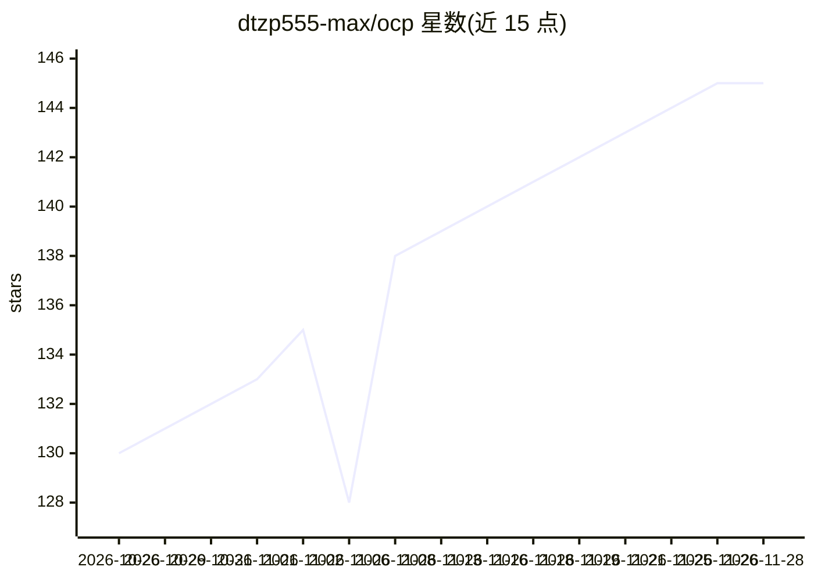

# dtzp555-max/ocp

⭐ 145 · JavaScript · MIT · 推送 2026-11-27 · [GitHub](https://github.com/dtzp555-max/ocp) · 个人维护

**把 Claude Pro/Max 订阅转为 OpenAI 兼容 API 的本地代理**

OCP 在本地启动一个 OpenAI 兼容代理（默认端口 3456），将 /v1/chat/completions 请求翻译为官方 claude CLI 的 stream-json 调用，从而让支持 OPENAI_BASE_URL 的 IDE 工具直接使用订阅额度。提供 LAN 多用户密钥、每密钥配额、可选响应缓存、SSE 心跳；通过 git clone + node setup.mjs 安装，需 Node.js 22.13+/23.4+ 与 Claude CLI。Windows 不支持 TUI 模式与 ocp CLI。

## 筛选速览

| 维度 | 判定 | 备注 |
|---|---|---|
| AI 角色 | `ai-ecosystem` | LLM/agent 周边工具 |
| 许可风险 | `permissive` | MIT |
| 部署形态 | `desktop` | 安装包/桌面程序 |
| 模型依赖 | locked-api |  |
| 硬件要求 | — | 无带数字的原话,不猜 |
| 安装摩擦 | `low` | 无编译、无系统依赖或容器化 |
| 成熟度 | `idea` | |

## 能力要点

- 将 Claude Pro/Max 订阅转为 OpenAI 兼容 API 端点
- LAN 多用户密钥与每密钥日/周/月配额
- 以 spawn 官方 CLI 方式运行，不提取 OAuth 令牌或修改二进制
- ALIGNMENT.md 与 CI 工作流约束端点与 cli.js 对齐

## 适用场景

- 让 Cline/Aider/Continue.dev 等 IDE 工具复用已有 Claude 订阅
- 在局域网多台设备间共享一份订阅并分别计量
- 为孩子的设备设置每日请求配额

## 场景标签

`模型网关` · 领域:Agent 开发

## 证据(README 行号)

> L11: OCP turns your Claude Pro/Max subscription into a standard OpenAI-compatible API on localhost. Any tool that speaks
> L16: Aider          ───┼──→ OCP :3456 ──→ Claude CLI ──→ Your subscription
> L163: OCP translates OpenAI-compatible `/v1/chat/completions` requests into `claude --output-format stream-json` CLI cal

## 星数曲线

2026-10-26 130 → 2026-11-28 145（+15）

---
*卡片 v1 · prompt 1.4 · 生成 2026-11-28 · 置信度 mid · 依据 README sha `2ec0a2b2d70a` · [字段定义](../../DATASET.md)*
