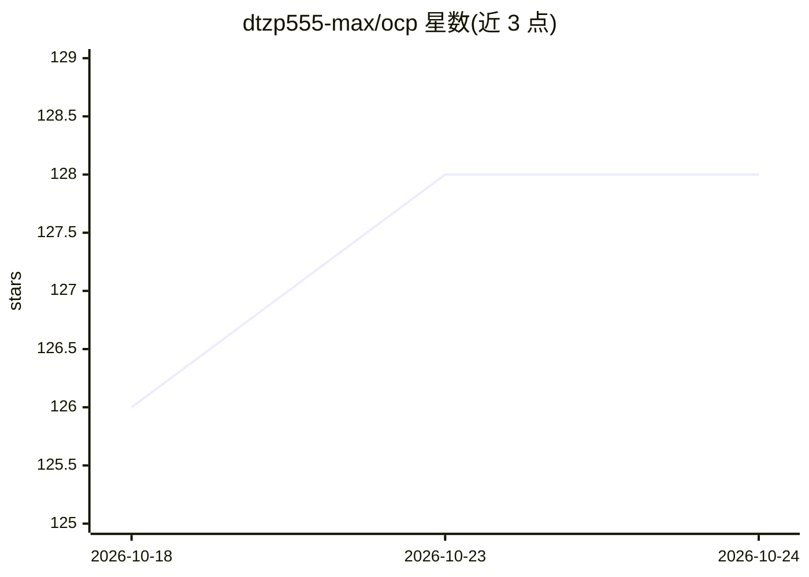

# dtzp555-max/ocp

⭐ 128 · JavaScript · MIT · 推送 2026-10-21 · [GitHub](https://github.com/dtzp555-max/ocp) · 个人维护

**把 Claude Pro/Max 订阅转成 OpenAI 兼容 API 的本地代理**

OCP 在 localhost:3456 起代理，将 OpenAI 兼容的 /v1/chat/completions 请求转译为官方 claude CLI 调用，使 Cline、OpenCode、Aider、Continue.dev 等工具复用已有订阅且无额外 API 计费。机制上严格对齐 cli.js 真实用到的端点（CI 校验），不提取 OAuth token 或打补丁。支持 LAN 多用户密钥、每密钥配额、可选 SHA-256 响应缓存、SSE 心跳。面向持有 Claude Pro/Max 订阅的开发者；单一维护者、pre-1.0、仅限 Claude。

## 筛选速览

| 维度 | 判定 | 备注 |
|---|---|---|
| AI 角色 | `ai-ecosystem` | LLM/agent 周边工具 |
| 许可风险 | `permissive` | MIT |
| 部署形态 | `desktop` | 安装包/桌面程序 |
| 模型依赖 | locked-api |  |
| 硬件要求 | — | 无带数字的原话,不猜 |
| 安装摩擦 | `low` | 无编译、无系统依赖或容器化 |
| 成熟度 | `idea` | |

## 能力要点

- OpenAI 兼容端点转译为官方 claude CLI 调用，复用订阅额度
- LAN 多用户密钥、每密钥日/周/月配额与一键吊销
- 可选按密钥隔离的 SHA-256 响应缓存（含 singleflight 防击穿）
- cli.js 对齐契约 + CI 工作流阻止编造端点

## 适用场景

- 让 Cline/Aider/Continue 等 IDE 工具直接用我的 Claude 订阅
- 家里多台设备经局域网共用一个订阅并按设备限额
- 长推理任务中保持 SSE 连接不断线

## 场景标签

`模型网关` · 领域:Agent 开发

## 证据(README 行号)

> L11: OCP turns your Claude Pro/Max subscription into a standard OpenAI-compatible API on localhost. Any tool that speaks
> L160: Your IDE → OCP (localhost:3456) → claude --output-format stream-json CLI → Anthropic (via subscription)

## 星数曲线

2026-10-18 126 → 2026-10-24 128（+2）

---
*卡片 v1 · prompt 1.4 · 生成 2026-10-23 · 置信度 high · 依据 README sha `9b7e95ffdb15` · [字段定义](../../DATASET.md)*
