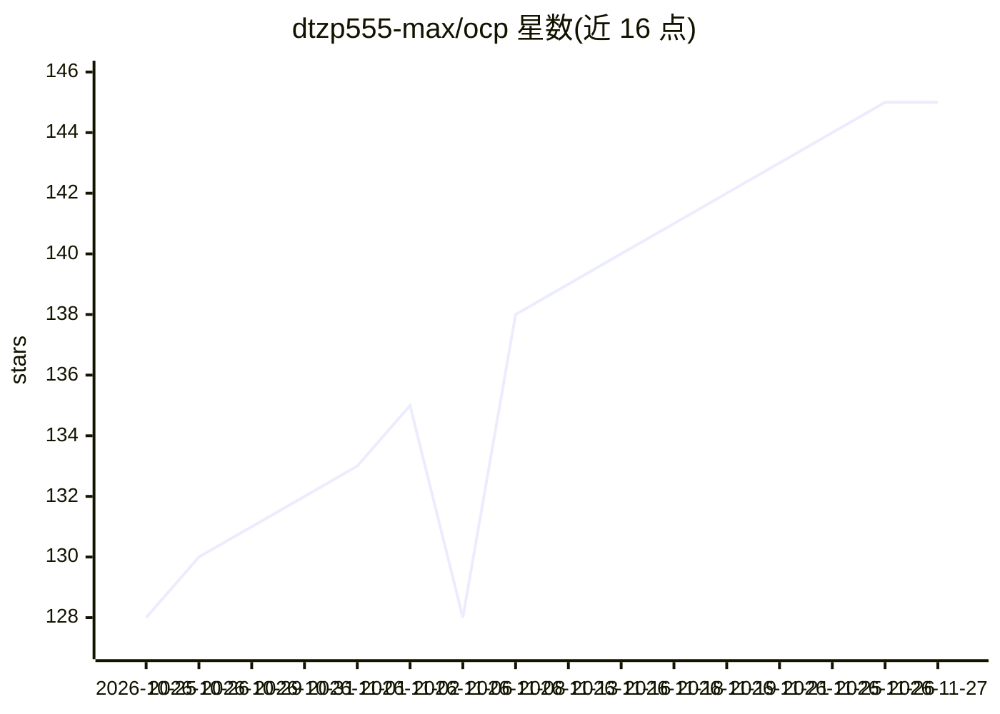

# dtzp555-max/ocp

⭐ 145 · JavaScript · MIT · 推送 2026-11-26 · [GitHub](https://github.com/dtzp555-max/ocp) · 个人维护

**把 Claude Pro/Max 订阅转为 OpenAI 兼容 API 的本地代理**

OCP 在 localhost 运行代理，将 OpenAI 兼容的 /v1/chat/completions 请求转换为官方 claude CLI 调用，使 IDE 与设备以订阅计费使用 Claude（L160-163）。面向已有 Claude Pro/Max 订阅的开发者与家庭/小团队。关键机制：LAN 多用户 per-key 鉴权与配额、可选 SHA-256 响应缓存、SSE 心跳、以 ALIGNMENT.md 约束端点与 cli.js 对齐并由 CI 拦截漂移（L29-34）。限制：仅支持 Claude、单维护者、pre-1.0，需 Node.js 与 Claude CLI，Windows 不支持 TUI 模式。

## 筛选速览

| 维度 | 判定 | 备注 |
|---|---|---|
| AI 角色 | `ai-ecosystem` | LLM/agent 周边工具 |
| 许可风险 | `permissive` | MIT |
| 部署形态 | `desktop` | 安装包/桌面程序 |
| 模型依赖 | locked-api |  |
| 硬件要求 | — | 无带数字的原话,不猜 |
| 安装摩擦 | `low` | 无编译、无系统依赖或容器化 |
| 成熟度 | `idea` | |

## 能力要点

- LAN 多用户 per-key 鉴权，每键独立用量追踪与配额
- 可选 per-key 隔离的 SHA-256 响应缓存，含并发防护
- ALIGNMENT.md + CI 强制端点与 cli.js 对齐
- ocp-connect 一条命令自动配置 OpenClaw 并检测常见 IDE

## 适用场景

- 让 Cline/Aider/Continue.dev 等 IDE 工具使用 Claude 订阅而非 API 计费
- 家庭/小团队在局域网内共享一个订阅并按设备设配额
- 在 Pi/NAS/VPS 等无头设备上部署订阅代理

## 场景标签

`模型网关` · 领域:Agent 开发

## 证据(README 行号)

> L11: OCP turns your Claude Pro/Max subscription into a standard OpenAI-compatible API on localhost. Any tool that speaks
> L163: OCP translates OpenAI-compatible `/v1/chat/completions` requests into `claude --output-format stream-json` CLI cal

## 星数曲线

2026-10-25 128 → 2026-11-27 145（+17）

---
*卡片 v1 · prompt 1.4 · 生成 2026-11-27 · 置信度 high · 依据 README sha `6e09dd442797` · [字段定义](../../DATASET.md)*
