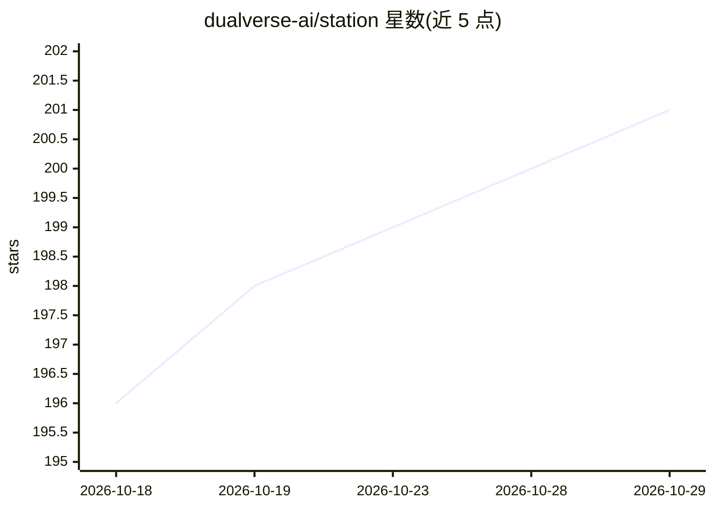

# dualverse-ai/station

⭐ 201 · Python · Apache-2.0 · 推送 2026-10-14 · [GitHub](https://github.com/dualverse-ai/station) · [官网](https://dualverse.ai/station/) · 组织维护 · 中文 README

**开放世界多智能体科研环境：驱动 AI agent 自主科学发现**

Station 是一个建模微型科学生态系统的开放世界多智能体环境，用于可评分、快速迭代（单次约 2 小时内）的科研任务，如架构搜索、优化、计算生物学与数学构造。环境默认生成 Gemini、GPT、Claude 多模型 agent，运行需 API key 与 OpenAI Codex CLI；通过 conda/pip 源码安装，deploy.sh 部署后以 dashboard 管控，支持 GPU/CPU 分配、多实例与 human-in-the-loop 交互。项目发表了多篇 arXiv 论文并报告数学发现结果。

## 筛选速览

| 维度 | 判定 | 备注 |
|---|---|---|
| AI 角色 | `ai-ecosystem` | LLM/agent 周边工具 |
| 许可风险 | `permissive` | Apache-2.0 |
| 部署形态 | `library` | 以包/库形式分发 |
| 模型依赖 | locked-api |  |
| 硬件要求 | — | 无带数字的原话,不猜 |
| 安装摩擦 | `low` | 无编译、无系统依赖或容器化 |
| 成熟度 | — | 结构信号不足 |

## 能力要点

- 多模型 agent 阵容默认自动生成，可自行指定或 dashboard 手动创建
- 支持可配置 GPU/CPU 资源分配与多实例并行运行
- dashboard 支持 agent 对话查看、人工介入与多分支 multistart 探索
- 附 arXiv 论文与在线 Viewer 展示研究过程

## 适用场景

- 在可评分的科研任务（优化、数学构造、计算生物学）上运行多 agent 自主探索
- 通过 dashboard 跟踪各 agent 研究过程并人工引导
- 复现论文设置或与研究者合作提交任务

## 场景标签

`多智能体` `科研工具` · 领域:Agent 开发

## 证据(README 行号)

> L31: The STATION is an open-world, multi-agent environment that models a miniature scientific ecosystem and helps resear
> L44: Good fits include architecture search, code discovery, optimization, computational biology, mathematical constructi
> L62: **2025-11-09 v1.0 initial announcement.** We announced Station v1.0, which achieved new state-of-the-art performanc

## 星数曲线

2026-10-18 196 → 2026-10-29 201（+5）

---
*卡片 v1 · prompt 1.4 · 生成 2026-10-22 · 置信度 high · 依据 README sha `988934d183b7` · [字段定义](../../DATASET.md)*
