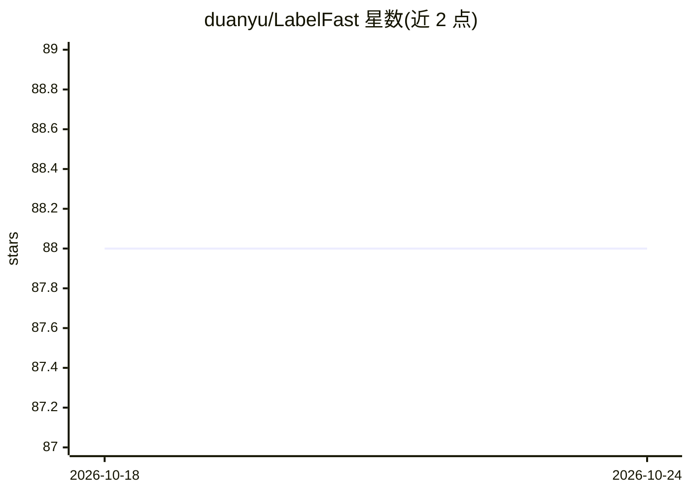

# duanyu/LabelFast

⭐ 88 · Python · 推送 2025-12-07 · [GitHub](https://github.com/duanyu/LabelFast) · [官网](https://modelscope.cn/studios/duanyu/LabelFast/summary) · 个人维护 · 中文 README

**中文 NLP 自动标注开源工具：LLM 标注简单样本并给置信度**

面向中文 NLP 数据标注场景的开源工具：提供文本多分类（CLS）与命名实体识别（NER）两类标注任务，由 finetuned mT5 与 seqgpt-560M 模型驱动，无需微调与 Prompt 工程即可开始标注。每个标注结果附带基于 First Token Prob 方法的 Confidence 信息，供使用者判断何时信任模型输出，从而让人只处理少量难样本。以 Python 库形式使用（建议 conda + python 3.10，依赖 torch），ModelScope 上提供仅含 mT5/CLS 的在线 Demo。

## 筛选速览

| 维度 | 判定 | 备注 |
|---|---|---|
| AI 角色 | `ai-native` | 本体是模型或模型工具 |
| 许可风险 | `none` | — |
| 部署形态 | `library` | 以包/库形式分发 |
| 模型依赖 | — | README 未给出锁定关系 |
| 硬件要求 | — | 无带数字的原话,不猜 |
| 安装摩擦 | `low` | 无编译、无系统依赖或容器化 |
| 成熟度 | `idea` | |

## 能力要点

- 开箱即用：无需微调和 Prompt 工程
- 标注结果附带 First Token Prob 置信度信息
- 支持 CLS 文本多分类与 NER 命名实体识别（mt5、seq-gpt 模型）
- 提供 ModelScope 在线 Demo

## 适用场景

- 批量预标注中文文本分类或 NER 数据，人工只复核难样本
- 借助置信度信息筛选可信的自动标注结果
- 降低数据标注的人力成本

## 场景标签

 · 领域:NLP/数据标注

## 证据(README 行号)

> L3: LabelFast是中文世界的NLP自动标注开源工具，旨在用LLM技术，快速识别并标注简单文本数据。
> L20: |CLS|mt5、seq-gpt|
> L21: |NER|seq-gpt|

## 星数曲线

2026-10-18 88 → 2026-10-24 88（+0）

---
*卡片 v1 · prompt 1.4 · 生成 2026-10-23 · 置信度 high · 依据 README sha `fe65ddb4977f` · [字段定义](../../DATASET.md)*
