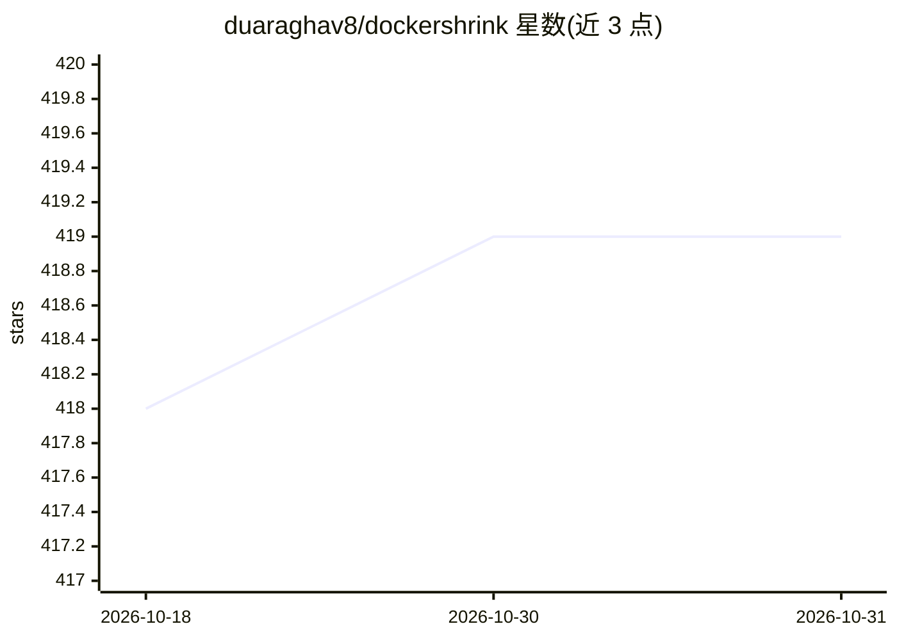

# duaraghav8/dockershrink

⭐ 419 · Go · MPL-2.0 · 推送 2026-02-26 · [GitHub](https://github.com/duaraghav8/dockershrink) · 个人维护

**AI 辅助缩减 Docker 镜像体积的命令行工具（当前仅 Node.js）**

面向容器使用者的独立二进制 CLI：`optimize` 命令对既有 Dockerfile/.dockerignore 应用多阶段构建、轻量基础镜像（如 alpine）、依赖检查等优化；`generate` 命令为新项目生成优化后的镜像定义。AI 部分通过任意 OpenAI 兼容端点（含 OpenAI、Anthropic、AWS Bedrock、Ollama）调用，optimize 可选启用 AI，generate 必须使用。当前仅支持 Node.js 应用，自述为 BETA 软件；macOS 需经 Homebrew 安装（二进制未公证）。API key 不做持久化存储，每次使用需重新提供。

## 筛选速览

| 维度 | 判定 | 备注 |
|---|---|---|
| AI 角色 | `ai-enhanced` | 去掉 AI 部分产品仍成立 |
| 许可风险 | `permissive` | MPL-2.0 |
| 部署形态 | `desktop` | 安装包/桌面程序 |
| 模型依赖 | local-ok | 支持本地模型 |
| 硬件要求 | — | 无带数字的原话,不猜 |
| 安装摩擦 | `low` | 无编译、无系统依赖或容器化 |
| 成熟度 | `idea` | |

## 能力要点

- optimize 对既有 Dockerfile 应用多阶段构建、alpine 等轻量基础镜像与依赖检查
- generate 为新项目生成 Dockerfile 与 .dockerignore
- AI 功能可接入任意 OpenAI 兼容端点（OpenAI/Anthropic/Bedrock/Ollama）
- 独立二进制分发，Homebrew 安装，支持本地 Ollama 模型

## 适用场景

- 我要减小现有 Node.js 项目的 Docker 镜像体积以降低存储与传输成本
- 为新项目直接生成优化过的 Dockerfile 和 .dockerignore
- 在本地用 Ollama 模型跑 AI 优化而不依赖云 API

## 场景标签

`代码生成` · 领域:编码与开发

## 证据(README 行号)

> L5: Dockershrink is an AI-powered Commandline Tool that helps you reduce the size of your Docker images
> L89: > Using AI features is optional for "optimize" (but highly recommended) and mandatory for "generate".

## 星数曲线

2026-10-18 418 → 2026-10-31 419（+1）

---
*卡片 v1 · prompt 1.4 · 生成 2026-10-21 · 置信度 mid · 依据 README sha `28b46578d85c` · [字段定义](../../DATASET.md)*
