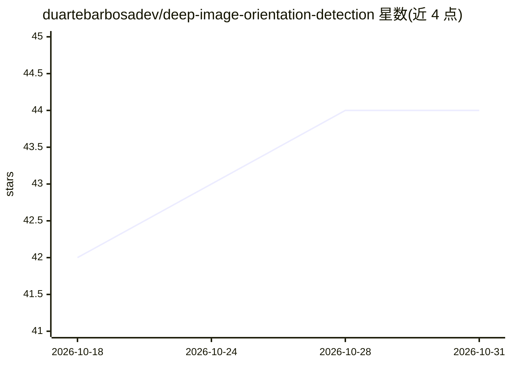

# duartebarbosadev/deep-image-orientation-detection

⭐ 44 · Python · MIT · 推送 2026-04-10 · [GitHub](https://github.com/duartebarbosadev/deep-image-orientation-detection) · 个人维护

**检测并纠正图像方向（0°/90°/180°/270°）的深度学习模型**

基于 PyTorch EfficientNetV2 微调的图像方向分类模型，将图像判为四个旋转类别并据此纠正朝向；v2 在 189,018 张唯一图像（四向旋转增广为 756,072 样本）上训练，验证集准确率 98.82%。提供 predict.py 推理脚本、ONNX 导出与 ONNX 推理（支持 CPU/CUDA/Apple MPS/ROCm 后端）、train.py 自定义训练与 TensorBoard 监控。预训练权重（.pth/.onnx）从 GitHub Releases 下载，模型也发布在 Hugging Face。

## 筛选速览

| 维度 | 判定 | 备注 |
|---|---|---|
| AI 角色 | `ai-native` | 本体是模型或模型工具 |
| 许可风险 | `permissive` | MIT |
| 部署形态 | `desktop` | 安装包/桌面程序 |
| 模型依赖 | — | README 未给出锁定关系 |
| 硬件要求 | — | 无带数字的原话,不猜 |
| 安装摩擦 | `medium` | 含编译或系统依赖之一 |
| 成熟度 | — | 结构信号不足 |

## 能力要点

- 四分类（0°/90°/180°/270°）方向检测，验证集准确率 98.82%
- 支持 ONNX 导出与推理，可选用 GPU 加速（CUDA/MPS/ROCm）
- 训练脚本自动生成旋转增广并缓存，集成 TensorBoard
- 支持单张图片或整个目录批量预测

## 适用场景

- 批量纠正扫描或导入图片的朝向
- 将旋转图片归正后再进入后续视觉流程
- 用自己的图片数据集重新训练方向分类模型

## 场景标签

`图像视频处理` · 领域:感知与多模态

## 证据(README 行号)

> L7: This project implements a deep learning model to detect the orientation of images and determine the rotation needed 
> L17: The model is trained on a dataset of images, where each image is rotated by 0°, 90°, 180°, and 270°. The model lear

## 星数曲线

2026-10-18 42 → 2026-10-31 44（+2）

---
*卡片 v1 · prompt 1.4 · 生成 2026-10-25 · 置信度 high · 依据 README sha `c5fc4f5467f2` · [字段定义](../../DATASET.md)*
