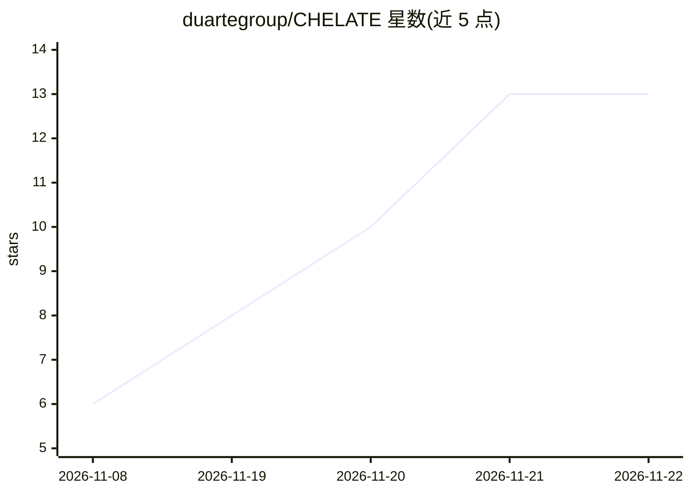

# duartegroup/CHELATE

⭐ 13 · Jupyter Notebook · MIT · 推送 2026-11-06 · [GitHub](https://github.com/duartegroup/CHELATE) · [官网](https://doi.org/10.5281/zenodo.24013764) · 组织维护

**金属蛋白对接后过滤器：预测并剔除金属配位错误的构象**

CHELATE 是针对金属蛋白-配体复合物的机器学习对接后过滤器，预测每个构象中金属结合基团相对晶体位置的 RMSD，按阈值剔除配位不正确的构象，再用对接程序自身分数对存活构象重排。随包附带 Vina/Smina/GNINA 的训练模型，无需晶体结构即可运行。仓库同时提供基于 PLINDER 子集的精选数据集、六种对接程序的 benchmark 流程与训练评估脚本。pip 安装即可使用，完整 benchmark 需 conda 双环境与外部对接程序。

## 筛选速览

| 维度 | 判定 | 备注 |
|---|---|---|
| AI 角色 | `ai-native` | 本体是模型或模型工具 |
| 许可风险 | `permissive` | MIT |
| 部署形态 | `library` | 以包/库形式分发 |
| 模型依赖 | — | README 未给出锁定关系 |
| 硬件要求 | — | 无带数字的原话,不猜 |
| 安装摩擦 | `medium` | 含编译或系统依赖之一 |
| 成熟度 | — | 结构信号不足 |

## 能力要点

- 预测金属结合基团 RMSD 并按阈值过滤构象，无需晶体结构
- 随包附带 Vina、Smina、GNINA 三个训练模型，单次调用完成重排
- 提供精选数据集与六种对接程序（Vina/smina/GNINA/AutoDock GPU/GPDOCK/MetalloDock）的再对接与交叉对接 benchmark
- 支持 PDBQT/SDF 输入，可自定义 cutoff 权衡覆盖率与精度

## 适用场景

- 金属蛋白对接后剔除金属配位错误的构象
- 复现论文中的六程序对接 benchmark
- 基于公开数据集训练自己的重排模型

## 场景标签

`科研工具` · 领域:学习与行业

## 证据(README 行号)

> L13: 3. Developing CHELATE, a machine-learning post-docking filter that predicts how far a pose places the metal-binding
> L42: No crystal structure is required — CHELATE predicts how far each pose's metal-binding group is likely to sit from t

## 星数曲线

2026-11-08 6 → 2026-11-22 13（+7）

---
*卡片 v1 · prompt 1.4 · 生成 2026-11-20 · 置信度 high · 依据 README sha `52325c020f6b` · [字段定义](../../DATASET.md)*
