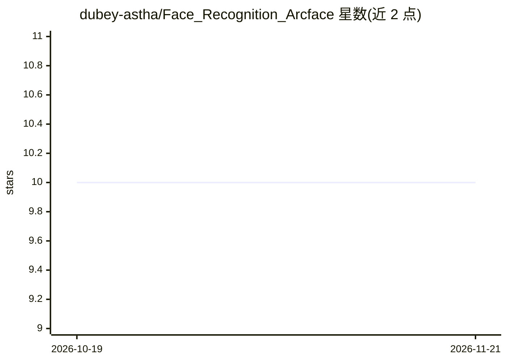

# dubey-astha/Face_Recognition_Arcface

⭐ 10 · JavaScript · MIT · 推送 2026-01-21 · [GitHub](https://github.com/dubey-astha/Face_Recognition_Arcface) · 个人维护

**基于 ArcFace/InsightFace 的人脸识别系统，含考勤扩展**

基于 ArcFace（InsightFace buffalo_l）的模块化人脸识别系统，流程覆盖人脸检测、嵌入生成、CSV 存储、余弦相似度匹配与阈值决策，输出带置信度的身份结果。支持实时摄像头识别与离线嵌入评估，可在 CPU 上运行，无需训练分类器。附带学生考勤系统扩展，数据集因隐私与许可原因不含在内，仅用于教育与研究用途。

## 筛选速览

| 维度 | 判定 | 备注 |
|---|---|---|
| AI 角色 | `ai-native` | 本体是模型或模型工具 |
| 许可风险 | `permissive` | MIT |
| 部署形态 | `library` | 以包/库形式分发 |
| 模型依赖 | — | README 未给出锁定关系 |
| 硬件要求 | — | 无带数字的原话,不猜 |
| 安装摩擦 | `low` | 无编译、无系统依赖或容器化 |
| 成熟度 | — | 结构信号不足 |

## 能力要点

- ArcFace (InsightFace buffalo_l) 生成人脸嵌入，余弦相似度匹配
- 可配置相似度阈值做置信度决策
- 实时摄像头识别与离线嵌入评估
- CPU 兼容运行，无需训练分类器

## 适用场景

- 学生考勤系统
- 身份验证原型验证
- 人脸识别课程演示与研究实验
- 门禁概念验证

## 场景标签

`人脸识别` · 领域:感知与多模态

## 证据(README 行号)

> L3: A modular, high-accuracy face recognition system built using **ArcFace (InsightFace – buffalo_l)**.
> L46: - Real-time inference using webcam

## 星数曲线

2026-10-19 10 → 2026-11-21 10（+0）

---
*卡片 v1 · prompt 1.4 · 生成 2026-11-19 · 置信度 high · 依据 README sha `5e090ea69fd1` · [字段定义](../../DATASET.md)*
