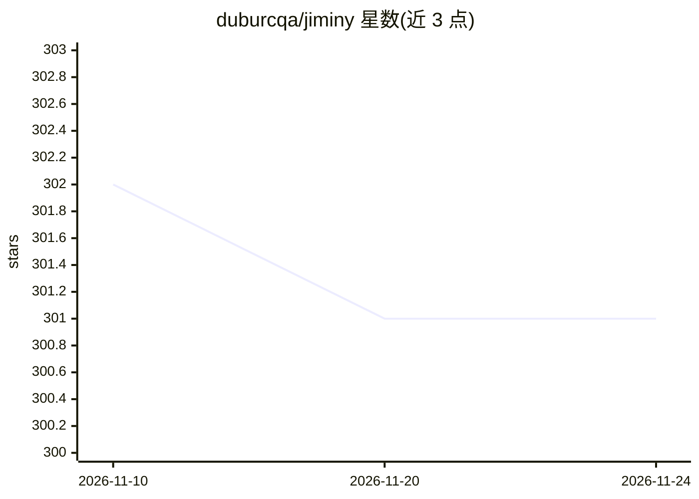

# duburcqa/jiminy

⭐ 301 · Jupyter Notebook · MIT · 推送 2026-11-04 · [GitHub](https://github.com/duburcqa/jiminy) · [官网](https://duburcqa.github.io/jiminy) · 个人维护

**面向机器人强化学习的快速多体动力学仿真器**

跨平台 Python/C++ 开源多关节系统物理仿真器，基于 Pinocchio 库采用最小坐标与拉格朗日动力学模拟铰接系统，C++ 内核带完整 Python 绑定。面向机器人学与机器学习研究：通过 Gym-Jiminy 模块兼容 OpenAI Gym 标准 API，一行代码将机器人封装为 Gym 环境，支持可插拔观测器/控制器、可组合奖励与终止条件、传感器噪声与参数随机化等域随机化机制；预置 cartpole、ANYmal、Cassie 等环境，兼容 Stable Baselines 3、Tianshou、Rllib 等学习框架。支持 Linux/Mac/Windows，PyPI 预编译二进制 pip 安装，兼容 Python3.10+；接触/碰撞目前仅支持固定接触点集合（primitives 与 meshes 尚未支持）。

## 筛选速览

| 维度 | 判定 | 备注 |
|---|---|---|
| AI 角色 | `ai-ecosystem` | LLM/agent 周边工具 |
| 许可风险 | `permissive` | MIT |
| 部署形态 | `library` | 以包/库形式分发 |
| 模型依赖 | — | README 未给出锁定关系 |
| 硬件要求 | — | 无带数字的原话,不猜 |
| 安装摩擦 | `low` | 无编译、无系统依赖或容器化 |
| 成熟度 | — | 结构信号不足 |

## 能力要点

- 最小坐标与拉格朗日动力学，基于 Pinocchio 的动力学量及导数计算
- Gym-Jiminy 兼容 OpenAI Gym API，一行代码封装机器人为学习环境
- 多铰接系统同时仿真，支持多智能体学习与集群机器人
- 仿真日志驻留内存，可导出二进制或 HDF5；Meshcat 交互式 3D 查看

## 适用场景

- 为强化学习算法提供机器人运动/步行任务的仿真训练环境
- 在 Colab/Jupyter 远程环境中交互调试机器人仿真
- 多智能体或集群机器人学习任务的并行仿真

## 场景标签

`强化学习` · 领域:训练与推理

## 证据(README 行号)

> L20: Beside a strong focus on performance to answer machine learning's need for running computationally demanding distri
> L29: - Designed with machine learning in mind, with seamless wrapping of robots as OpenAI Gym environments using one-lin

## 星数曲线

2026-11-10 302 → 2026-11-24 301（-1）

---
*卡片 v1 · prompt 1.4 · 生成 2026-11-17 · 置信度 high · 依据 README sha `814cce3bc667` · [字段定义](../../DATASET.md)*
