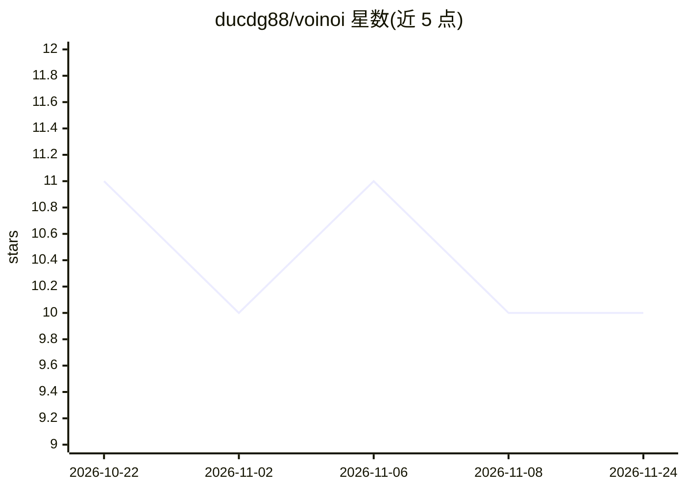

# ducdg88/voinoi

⭐ 10 · Python · MIT · 推送 2026-09-29 · [GitHub](https://github.com/ducdg88/voinoi) · [官网](https://ducpt.com/bai-viet/vietnamese-voice-mic-coding-bang-giong-noi/) · 个人维护

**越南语语音输入 Windows 工具：说话即出字到任意输入框**

Windows 后台运行的越南语语音应用，三种模式：把越南语语音转成文字并粘贴到当前选中的输入框、文档朗读（txt/md/pdf/docx/html/epub/网页/文件夹）、与 AI 语音对话。识别以 Google Speech Recognition 为主，Whisper 可选作备用（可配置 small 等模型）；朗读用 edge-tts 生成越南语语音并缓存。通过 Alt+click 环形菜单操作，支持剪贴板重贴、识别历史本地保存、开机自启与 .exe 自更新（SHA-256 校验）。需联网，仅支持 Windows 10/11。

## 筛选速览

| 维度 | 判定 | 备注 |
|---|---|---|
| AI 角色 | `ai-native` | 本体是模型或模型工具 |
| 许可风险 | `permissive` | MIT |
| 部署形态 | `desktop` | 安装包/桌面程序 |
| 模型依赖 | local-ok | 支持本地模型 |
| 硬件要求 | — | 无带数字的原话,不猜 |
| 安装摩擦 | `low` | 无编译、无系统依赖或容器化 |
| 成熟度 | — | 结构信号不足 |

## 能力要点

- 语音转文字并粘贴到任意选中的输入框，支持语音自学习词汇表
- Whisper 备用识别：对 Google 漏字/噪声段落单独重听修正
- 文档朗读支持网页全文抓取、epub/pdf/docx 等格式与文件夹批量
- 语音对话自动选择后端：Claude API / Claude Code CLI / 本地 Ollama

## 适用场景

- 在聊天框或编辑器里用越南语说话代替打字
- 用越南语朗读论文、电子书和网页文章
- 不方便动手时用语音与 AI 助手对话

## 场景标签

`语音识别` `语音合成` `语音 Agent` · 领域:对话与助手

## 证据(README 行号)

> L9: Ứng dụng Windows chạy nền: nói tiếng Việt thành chữ, dán đúng vào ô anh đang chọn. Kèm Trợ lý đọc (đọc to tài liệu)
> L69: 3. Chọn "Gõ chữ", nói nội dung. Ngừng nói thì app tự nhận diện và dán vào đúng chỗ vừa `Alt + click`.
> L94: - Bộ não AI tự chọn theo thứ tự: Claude API (có `ANTHROPIC_API_KEY` và đã cài `anthropic`), Claude Code dòng lệnh

## 星数曲线

2026-10-22 11 → 2026-11-24 10（-1）

---
*卡片 v1 · prompt 1.4 · 生成 2026-11-19 · 置信度 high · 依据 README sha `a4df6a8a176e` · [字段定义](../../DATASET.md)*
