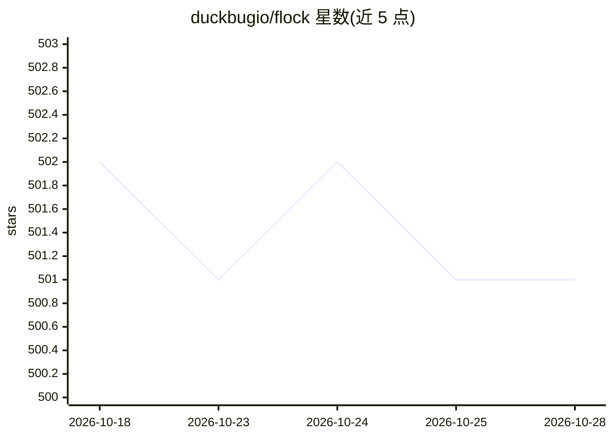

# duckbugio/flock

⭐ 501 · Go · MIT · 推送 2026-10-26 · [GitHub](https://github.com/duckbugio/flock) · [官网](https://roost.duckbug.io) · 组织维护 · 中文 README

**自托管 Claude Code AI 开发团队 bot，经聊天驱动交付 PR**

用 Go 编写的自托管机器人：在自有服务器上运行 Claude Code，通过 Telegram、VK 或 LO 聊天描述需求，由 planner→coder→tester→reviewer→arbiter 五个子代理组成团队在隔离容器工作区内建分支、构建、测试并开 PR。认证可用 Claude Pro/Max 订阅 token 或 Anthropic API key，以预构建 Docker 镜像分发，无需编译。支持自治循环（自验证、/goal 独立评审、/schedule 定时任务、CI 监视与自动合并）及 Telegram Secretary 代回消息模式。限制：需 Anthropic 支持地区，RU/CN 等被地理封锁。

## 筛选速览

| 维度 | 判定 | 备注 |
|---|---|---|
| AI 角色 | `ai-native` | 本体是模型或模型工具 |
| 许可风险 | `permissive` | MIT |
| 部署形态 | `self-host` | docker 或自建部署 |
| 模型依赖 | locked-api |  |
| 硬件要求 | — | 无带数字的原话,不猜 |
| 安装摩擦 | `low` | 无编译、无系统依赖或容器化 |
| 成熟度 | — | 结构信号不足 |

## 能力要点

- 五个子代理流水线：planner→coder→tester→reviewer→arbiter，带循环裁决者
- 自治循环：运行后自验证、/goal 独立评审、/schedule 定时任务、CI 监视与可选自动合并
- 预构建 Docker 镜像部署，每个聊天独立沙箱工作区
- 三种聊天平台适配（Telegram/VK/LO），轮询 git host 回流 PR 评论

## 适用场景

- 在聊天里描述功能，收到自动构建、测试并开好的 PR
- 微服务多仓库场景下协调跨服务分支与关联 PR
- 让 bot 定时执行任务或监视 CI 并自动修复红构建

## 场景标签

`编码 Agent` `多智能体` `代码审查` · 领域:Agent 开发

## 证据(README 行号)

> L12: **Run a Claude Code AI dev team on your server and drive it from chat.** Describe a feature in Telegram, VK or LO; 
> L19: It runs on your Claude **Pro/Max subscription** (no per-token billing) or an Anthropic API key, ships as **prebuilt
> L146:   → bot's Claude (Lead) → planner → confirm scope → coder ⇄ tester → PR per repo

## 星数曲线

2026-10-18 502 → 2026-10-28 501（-1）

---
*卡片 v1 · prompt 1.4 · 生成 2026-10-21 · 置信度 high · 依据 README sha `ab2edd4e34c5` · [字段定义](../../DATASET.md)*
