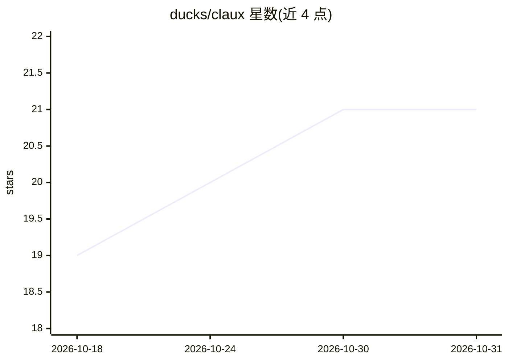

# ducks/claux

⭐ 21 · Rust · 推送 2026-10-25 · [GitHub](https://github.com/ducks/claux) · 个人维护

**Rust 终端 AI 编程助手：多提供商、工具执行与会话管理**

Rust 编写的终端 AI 编程助手（CLI/REPL/TUI）。功能包括流式对话与工具执行（Read/Write/Edit/Bash/WebFetch/Agent 等）、子代理、SQLite 会话持久化与搜索、交互式权限确认、任务保持式上下文压缩、按轮次 diff 与撤销、成本与 token 跟踪、提示缓存、后台任务面板。支持 Anthropic、OpenAI、Ollama 及任意 OpenAI 兼容端点，OpenRouter 提供 OAuth PKCE 登录、tokenizer 指纹对比与用量查询。通过 cargo 安装，需 Rust 1.88+。

## 筛选速览

| 维度 | 判定 | 备注 |
|---|---|---|
| AI 角色 | `ai-native` | 本体是模型或模型工具 |
| 许可风险 | `none` | — |
| 部署形态 | `library` | 以包/库形式分发 |
| 模型依赖 | local-ok | 支持本地模型 |
| 硬件要求 | — | 无带数字的原话,不猜 |
| 安装摩擦 | `low` | 无编译、无系统依赖或容器化 |
| 成熟度 | — | 结构信号不足 |

## 能力要点

- 流式对话与 8 种内置工具执行，含 Agent 子代理（继承会话权限模式）
- SQLite 会话持久化、/resume 精确恢复与 /undo-turn 安全回滚
- 多提供商支持：Anthropic、OpenAI、Ollama、任意 OpenAI 兼容端点
- OpenRouter OAuth 登录、tokenizer 指纹对比、用量与花费查询

## 适用场景

- 在终端里让 AI 读写代码、执行命令并做子任务分发
- 在多个模型提供商之间切换并跟踪 token 成本
- 长会话下自动压缩上下文并保留任务进度

## 场景标签

`编码 Agent` `AI 助手` · 领域:编码与开发

## 证据(README 行号)

> L3: A terminal-based AI coding assistant written in Rust. Streams responses, executes tools, manages sessions, and stays
> L32: - **Multi-provider** — Anthropic, OpenAI, Ollama, or any OpenAI-compatible endpoint
> L7: - **Streaming chat** with tool execution (Read, Write, Edit, Glob, Grep, Bash, WebFetch, Agent)

## 星数曲线

2026-10-18 19 → 2026-10-31 21（+2）

---
*卡片 v1 · prompt 1.4 · 生成 2026-10-28 · 置信度 high · 依据 README sha `ddc2645fd039` · [字段定义](../../DATASET.md)*
