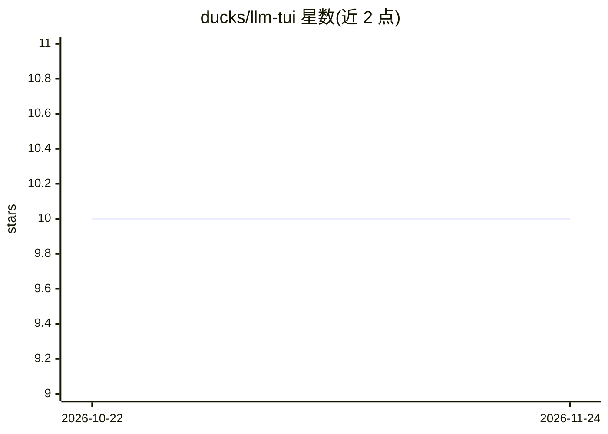

# ducks/llm-tui

⭐ 10 · Rust · 推送 2026-07-28 · [GitHub](https://github.com/ducks/llm-tui) · 个人维护

**面向终端用户的 vim 风格多供应商 LLM 聊天 TUI**

用 Rust 编写的终端 LLM 聊天界面：支持 Ollama、Anthropic、OpenAI、Gemini、AWS Bedrock 及任意 OpenAI 兼容端点，提供专门的供应商管理与模型管理界面（含 Ollama 模型拉取/删除）、6 个内置工具（Read/Write/Edit/Glob/Grep/Bash，均需用户确认）、按项目组织会话、SQLite 持久化存储、自动上下文压缩与 token 实时统计。安装途径为 crates.io 的 cargo install 或源码构建。注意：README 声明该项目已被 Claux 取代，仅维护供现有用户使用。

## 筛选速览

| 维度 | 判定 | 备注 |
|---|---|---|
| AI 角色 | `ai-ecosystem` | LLM/agent 周边工具 |
| 许可风险 | `none` | — |
| 部署形态 | `library` | 以包/库形式分发 |
| 模型依赖 | local-ok | 支持本地模型 |
| 硬件要求 | — | 无带数字的原话,不猜 |
| 安装摩擦 | `medium` | 含编译或系统依赖之一 |
| 成熟度 | — | 结构信号不足 |

## 能力要点

- 多供应商接入：Ollama/Anthropic/OpenAI/Gemini/AWS Bedrock/OpenAI 兼容端点
- 6 个内置工具（Read/Write/Edit/Glob/Grep/Bash）且执行需用户确认
- vim 风格模态编辑与按项目组织的会话管理
- 自动上下文压缩与 SQLite 会话存储

## 适用场景

- 在终端里通过 vim 快捷键与多个 LLM 供应商对话
- 管理本地 Ollama 模型的拉取、删除与默认供应商设置
- 按项目组织聊天会话并长期保存完整历史

## 场景标签

`聊天机器人` · 领域:对话与助手

## 证据(README 行号)

> L14: A terminal user interface for LLM chat sessions with multi-provider
> L22: - **Provider Management**: Dedicated screen to view, test, set
> L26: - **Tool System**: 6 built-in tools (Read, Write, Edit, Glob, Grep,

## 星数曲线

2026-10-22 10 → 2026-11-24 10（+0）

---
*卡片 v1 · prompt 1.4 · 生成 2026-11-19 · 置信度 high · 依据 README sha `f2145eae7894` · [字段定义](../../DATASET.md)*
