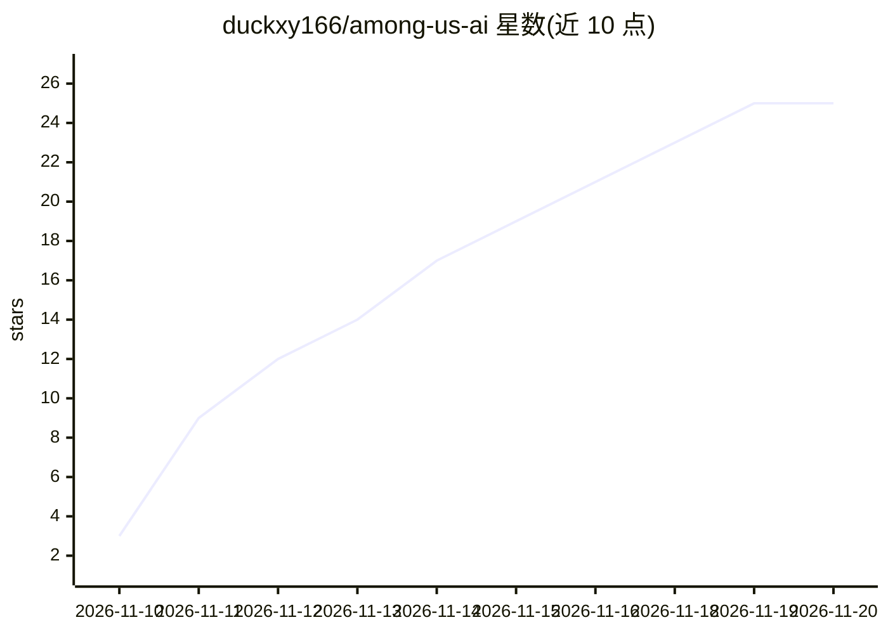

# duckxy166/among-us-ai

⭐ 25 · JavaScript · MIT · 推送 2026-11-10 · [GitHub](https://github.com/duckxy166/among-us-ai) · [官网](https://www.youtube.com/@LDuckxy) · 个人维护 · 中文 README

**让多个 LLM 互相对战 Among Us 社交推理游戏的竞技场**

用 Node.js 实现的 LLM 社交推理游戏（social deduction）竞技场：单场可容纳 4–10 个模型玩家，每个玩家拥有独立记忆日志与隐藏内心想法，行动与发言均由模型自行决策，无预设剧本。提供两种模式：内置 Skeld 模拟器（无需游戏本体）与通过 AUBridge mod 驱动真实 Among Us 游戏（Windows + BepInEx）。支持浏览器 viewer 观战、跨场次记忆笔记、可回放的 events.jsonl 事件日志，并可作为 npm 库（duckxy-among-ai）导入。

## 筛选速览

| 维度 | 判定 | 备注 |
|---|---|---|
| AI 角色 | `ai-native` | 本体是模型或模型工具 |
| 许可风险 | `permissive` | MIT |
| 部署形态 | `library` | 以包/库形式分发 |
| 模型依赖 | local-ok | 支持本地模型 |
| 硬件要求 | — | 无带数字的原话,不猜 |
| 安装摩擦 | `low` | 无编译、无系统依赖或容器化 |
| 成熟度 | — | 结构信号不足 |

## 能力要点

- 每个 AI 玩家独立记忆与 secret_thought，发言与内心想法分离
- 支持 Anthropic/OpenAI/Gemini/DeepSeek/Kimi/Grok/OpenRouter/Ollama 多阵营同场
- 无 API key 时可通过 claude-code/codex/antigravity CLI 订阅登录游玩
- 浏览器 viewer 实时观战 + events.jsonl 完整事件日志可回放

## 适用场景

- 让不同 LLM 同场竞技观察其推理与欺骗行为
- 免费 mock 模式预览游戏效果
- 在真实 Among Us 游戏中观看 AI 对局
- 基于事件日志开发自己的 overlay 或比赛总结工具

## 场景标签

`多智能体` `模型评测` · 领域:Agent 开发

## 证据(README 行号)

> L23: Among AI คือสนามเกมแนวหาตัวคนร้าย (social deduction) สำหรับโมเดลภาษา ผู้เล่นแต่ละคนเป็นโมเดลคนละตัว
> L30: 2. โมเดลตอบกลับเป็น **ความคิดในใจ** (แผนจริง) กับ **การกระทำ** (เดิน ทำงาน ฆ่า พูด โหวต)
> L61: - 🤖 **หลายค่ายในแมตช์เดียว** Anthropic, OpenAI, Gemini, DeepSeek, Kimi, Grok, OpenRouter, Ollama หรือ server

## 星数曲线

2026-11-10 3 → 2026-11-20 25（+22）

---
*卡片 v1 · prompt 1.4 · 生成 2026-11-18 · 置信度 high · 依据 README sha `4d8654ed2fca` · [字段定义](../../DATASET.md)*
