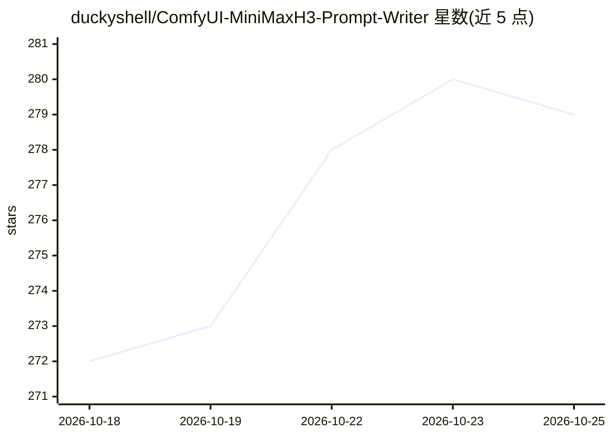

# duckyshell/ComfyUI-MiniMaxH3-Prompt-Writer

⭐ 281 · Python · MIT · 推送 2026-10-22 · [GitHub](https://github.com/duckyshell/ComfyUI-MiniMaxH3-Prompt-Writer) · 个人维护

**ComfyUI 扩展：为 MiniMax H3 视频模型编写提示词的工作台**

以 ComfyUI UI 扩展（非工作流节点）形式提供，用户输入自然语言 Creative Brief，可附图片/视频/音频参考，由本地或 API 提示词模型（Ollama、Direct GGUF、外部 llama.cpp、Gemini/OpenAI/OpenRouter 等）生成可编辑的 H3 格式提示词，再复制进既有 H3 工作流。包含 Sequence 分块写作、Media Composer/Editor、浮动媒体面板等功能；扩展不运行 MiniMax H3 本身。另有 Windows 独立版，界面与文档为英文。

## 筛选速览

| 维度 | 判定 | 备注 |
|---|---|---|
| AI 角色 | `ai-native` | 本体是模型或模型工具 |
| 许可风险 | `permissive` | MIT |
| 部署形态 | `None` |  |
| 模型依赖 | local-ok | 支持本地模型 |
| 硬件要求 | — | 无带数字的原话,不猜 |
| 安装摩擦 | `low` | 无编译、无系统依赖或容器化 |
| 成熟度 | — | 结构信号不足 |

## 能力要点

- 从 Creative Brief 生成符合 MiniMax H3 格式的可编辑提示词
- 支持 Ollama / Direct GGUF / 外部 llama.cpp / API 多类提示词模型提供方
- T2VA、I2VA、FL2VA、L2VA、Reference 五种模式，最多 9 图 3 视频 3 音频参考
- Sequence 工作区分块写作，含 Media Composer/Editor 媒体处理

## 适用场景

- 我想用自然语言给 MiniMax H3 写视频提示词而不用手写分段与时间戳
- 为 H3 工作流准备并标注图像/视频参考素材
- 本地 Ollama 模型下离线生成提示词以保护素材隐私

## 场景标签

`提示工程` · 领域:Agent 开发

## 证据(README 行号)

> L5: H3 Prompt Writer is a prompt-writing workspace for MiniMax H3 inside ComfyUI. Start with a plain-language Creative B
> L19: - Local and remote prompt models: Ollama, Direct GGUF, External llama.cpp, and APIs.

## 星数曲线

2026-10-18 272 → 2026-10-25 279（+7）

---
*卡片 v1 · prompt 1.4 · 生成 2026-10-22 · 置信度 high · 依据 README sha `b36259879d74` · [字段定义](../../DATASET.md)*
