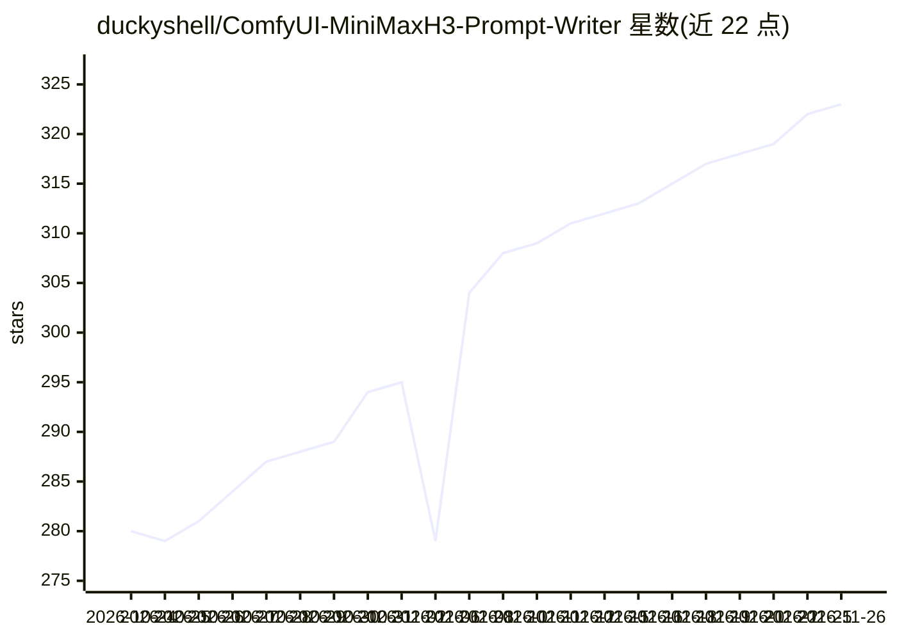

# duckyshell/ComfyUI-MiniMaxH3-Prompt-Writer

⭐ 323 · Python · MIT · 推送 2026-11-25 · [GitHub](https://github.com/duckyshell/ComfyUI-MiniMaxH3-Prompt-Writer) · 个人维护

**ComfyUI 插件：为 MiniMax H3 工作流生成提示词**

一个 ComfyUI 扩展（非工作流节点），提供提示词写作工作台：用户用自然语言 Creative Brief 描述视频并挂载图片/视频/音频参考，扩展将其发送给所选提示词模型，生成可编辑的 MiniMax H3 格式提示词，供复制到既有 H3 工作流。支持序列工作台、媒体拼贴与剪辑、浮动媒体面板；本地运行可选 Ollama、Direct GGUF、外部 llama.cpp，也可接 API。不运行 MiniMax H3 也不排队生成视频。提供 Windows 独立版。

## 筛选速览

| 维度 | 判定 | 备注 |
|---|---|---|
| AI 角色 | `ai-ecosystem` | LLM/agent 周边工具 |
| 许可风险 | `permissive` | MIT |
| 部署形态 | `None` |  |
| 模型依赖 | local-ok | 支持本地模型 |
| 硬件要求 | — | 无带数字的原话,不猜 |
| 安装摩擦 | `low` | 无编译、无系统依赖或容器化 |
| 成熟度 | — | 结构信号不足 |

## 能力要点

- Sequence 工作台：一个 brief 拆分为多个独立 H3 提示词块并共享媒体
- 本地提示词模型路径：Ollama、Direct GGUF、外部 llama.cpp server
- Media Editor 支持裁剪图片、剪辑视频、抽帧与联系表预览
- T2VA/I2VA/FL2VA/L2VA/Reference 五种模式，参考最多 9 图 3 视频 3 音频

## 适用场景

- 为已有 MiniMax H3 视频工作流快速编写规范提示词
- 本地（Ollama/GGUF）处理隐私敏感素材生成提示词
- 用联系表检查提示词模型实际看到的视频帧

## 场景标签

`提示工程` · 领域:Agent 开发

## 证据(README 行号)

> L5: H3 Prompt Writer is a prompt-writing workspace for MiniMax H3 inside ComfyUI. Start with a plain-language Creative B
> L7: It is a ComfyUI UI extension, not a workflow node. It writes prompt text for your existing H3 workflow and helps pre
> L19: - Local and remote prompt models: Ollama, Direct GGUF, External llama.cpp, and APIs.

## 星数曲线

2026-10-24 280 → 2026-11-26 323（+43）

---
*卡片 v1 · prompt 1.4 · 生成 2026-11-25 · 置信度 high · 依据 README sha `7aef958bf0a2` · [字段定义](../../DATASET.md)*
