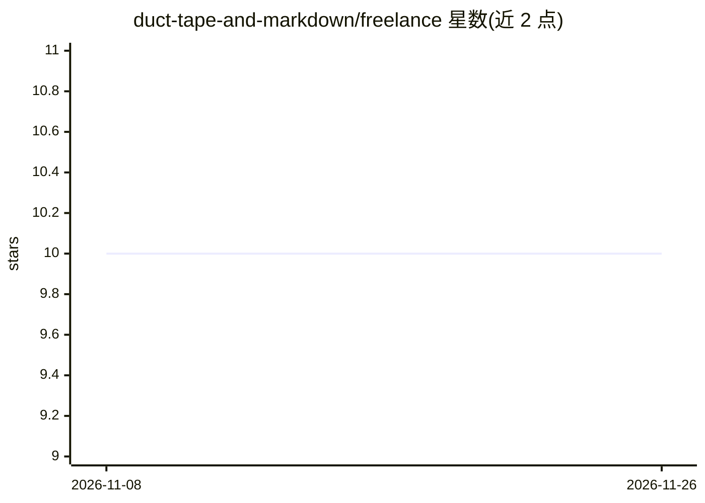

# duct-tape-and-markdown/freelance

⭐ 10 · TypeScript · MIT · 推送 2026-10-13 · [GitHub](https://github.com/duct-tape-and-markdown/freelance) · 个人维护

**给 AI 编码代理提供 YAML 工作流约束与持久知识图谱记忆的工具**

以 CLI（freelance-mcp）形式发布：用户在 YAML 中定义有向图工作流（action/decision/gate/wait/terminal 节点、子图嵌套、表达式条件、onEnter 钩子），代理通过 shell-out 调用 CLI 动词遍历，工具边界处强制流程，状态存于磁盘以在上下文压缩后保留。内置 SQLite 知识图谱：代理从源文件编译命题，读取时校验源文件哈希以标记过期。通过 MCP 与 Claude Agent Skill 接入，支持 Claude Code 插件安装及 Cursor/Windsurf/Cline 等客户端。

## 筛选速览

| 维度 | 判定 | 备注 |
|---|---|---|
| AI 角色 | `ai-ecosystem` | LLM/agent 周边工具 |
| 许可风险 | `permissive` | MIT |
| 部署形态 | `library` | 以包/库形式分发 |
| 模型依赖 | locked-api |  |
| 硬件要求 | — | 无带数字的原话,不猜 |
| 安装摩擦 | `low` | 无编译、无系统依赖或容器化 |
| 成熟度 | — | 结构信号不足 |

## 能力要点

- YAML 定义有向图工作流，含 gate 节点、子图组合与安全表达式求值
- SQLite 知识图谱按内容哈希检测源文件漂移，过期命题带置信信号返回
- 每次运行时调用输出结构化 JSON，语义化退出码分支
- 本地脚本钩子无沙箱，提供环境变量开关禁用脚本钩子

## 适用场景

- 为 AI 编码代理强制执行团队规定的工作流程
- 让代理在长会话中保留并增量积累项目知识
- 切换 git 分支时让记忆自动跟随源文件变化

## 场景标签

`工作流自动化` `知识图谱` · 领域:效率与自动化

## 证据(README 行号)

> L3: Graph-based workflow enforcement and persistent memory for AI coding agents.
> L5: Define structured workflows in YAML. Agents drive them through the `freelance` CLI, via a Claude Agent Skill that te

## 星数曲线

2026-11-08 10 → 2026-11-26 10（+0）

---
*卡片 v1 · prompt 1.4 · 生成 2026-11-19 · 置信度 high · 依据 README sha `deb5e6cac99f` · [字段定义](../../DATASET.md)*
