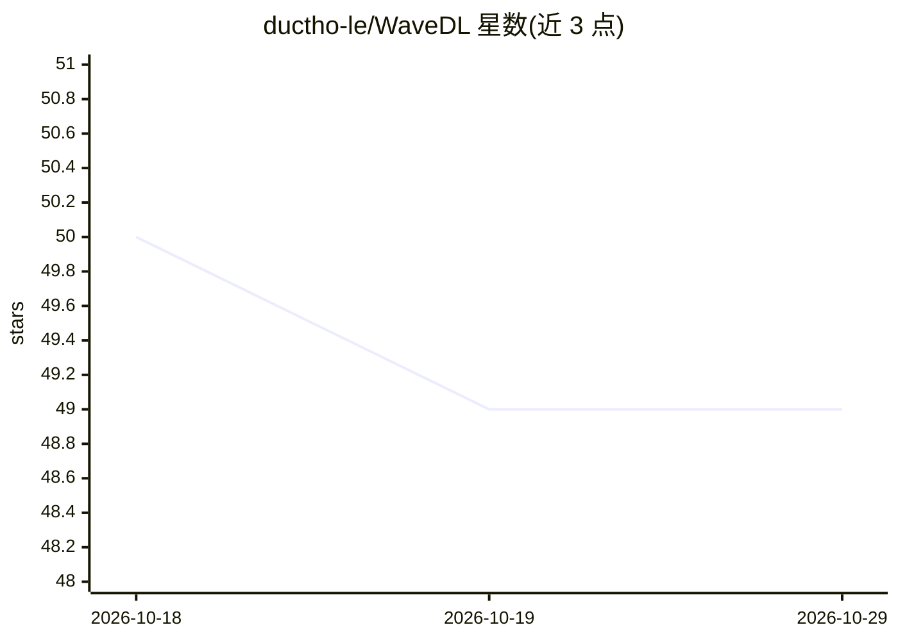

# ductho-le/WaveDL

⭐ 49 · Python · MIT · 推送 2026-10-20 · [GitHub](https://github.com/ductho-le/WaveDL) · 个人维护

**面向波动反演问题的可扩展深度学习训练框架，供科研与工程使用者**

WaveDL 是用于波动类反问题（超声无损检测、地球物理、生物医学组织表征等）的深度学习框架：将波形、频谱图、B-scan、频散曲线等 1D/2D/3D 输入映射为材料属性向量或稠密二维属性场。内置 20+ 架构（70+ 变体，含 CNN/ResNet/ViT/SSM/WaveNet/U-Net），支持多 GPU DDP 分布式训练、HPC（SLURM/PBS）部署、内存映射缓存、物理约束训练、断点恢复、ONNX 导出，并提供 CLI 训练/测试命令。自定义模型继承 BaseModel 即可接入。注意其稠密反演为监督学习，并非完整 FWI（不含微分波动求解器迭代回路）。经 PyPI 安装，需 Python 3.11+ 与 PyTorch 2.x。

## 筛选速览

| 维度 | 判定 | 备注 |
|---|---|---|
| AI 角色 | `ai-native` | 本体是模型或模型工具 |
| 许可风险 | `permissive` | MIT |
| 部署形态 | `library` | 以包/库形式分发 |
| 模型依赖 | — | README 未给出锁定关系 |
| 硬件要求 | — | 无带数字的原话,不猜 |
| 安装摩擦 | `medium` | 含编译或系统依赖之一 |
| 成熟度 | — | 结构信号不足 |

## 能力要点

- 20+ 模型架构（70+ 变体），支持向量回归与稠密 2D 场回归（U-Net）
- 多 GPU DDP 分布式训练与 HPC 集群（SLURM/PBS）自动适配
- 内存映射缓存处理 HDF5/MATLAB v7.3/NPZ 大规模数据
- 物理约束训练（边界/正定性/方程约束）与一键 ONNX 导出

## 适用场景

- 用超声波形/B-scan 回归材料属性或缺陷尺寸
- 稠密二维弹性/速度/密度场的监督反演制图
- 在 HPC 集群上做大规模分布式训练并断点恢复

## 场景标签

`科研工具` `模型训练` · 领域:学习与行业

## 证据(README 行号)

> L29: WaveDL is a **deep learning framework** built for **wave-based inverse problems** — from ultrasonic NDE and geophys
> L34: Output: Material properties, defect dimensions, elasticity/velocity maps, ...

## 星数曲线

2026-10-18 50 → 2026-10-29 49（-1）

---
*卡片 v1 · prompt 1.4 · 生成 2026-10-24 · 置信度 high · 依据 README sha `586dd581ea92` · [字段定义](../../DATASET.md)*
