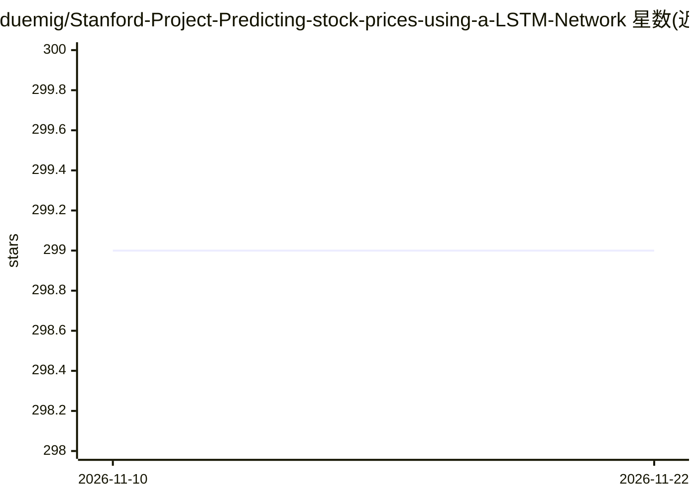

# duemig/Stanford-Project-Predicting-stock-prices-using-a-LSTM-Network

⭐ 299 · Jupyter Notebook · 推送 2026-11-10 · [GitHub](https://github.com/duemig/Stanford-Project-Predicting-stock-prices-using-a-LSTM-Network) · 个人维护

**斯坦福 CS230 课程项目：用 LSTM 预测 S&P 500 月度涨跌**

课程研究报告型代码库：比较 LSTM 网络、弹性网逻辑回归与梯度提升模型在 S&P 500 下月涨跌方向上的预测表现，基准为始终预测上涨的朴素规则。使用平稳特征（对数收益、滚动波动率、相对成交量）、purged walk-forward 交叉验证与含禁运期的数据划分，评估指标含准确率、AUC、Brier 分数与交易时机策略。README 结论为各模型表现接近基准；数据通过 yfinance 下载（Stooq 兜底），价格数据不入库。

## 筛选速览

| 维度 | 判定 | 备注 |
|---|---|---|
| AI 角色 | `ai-native` | 本体是模型或模型工具 |
| 许可风险 | `none` | — |
| 部署形态 | `library` | 以包/库形式分发 |
| 模型依赖 | — | README 未给出锁定关系 |
| 硬件要求 | — | 无带数字的原话,不猜 |
| 安装摩擦 | `low` | 无编译、无系统依赖或容器化 |
| 成熟度 | — | 结构信号不足 |

## 能力要点

- LSTM 与正则化基线模型的对比研究框架
- purged walk-forward 交叉验证与一个月 embargo 防止信息泄漏
- run_study.py 一键下载数据并复现全部结果与图表
- 含移动块 bootstrap 置信区间的评估与买入持有对比的时机策略测试

## 适用场景

- 复现或学习时间序列金融预测的完整实验流程
- 参考 purged CV 与防泄漏的标签构建方法
- 作为 LSTM 股价方向预测的负面结果案例阅读

## 场景标签

`金融量化` · 领域:学习与行业

## 证据(README 行号)

> L3: Can a long short term memory (LSTM) network predict whether the S&P 500 will be up
> L34:  gradient-boosting classifier on the aggregates, and an LSTM on the daily

## 星数曲线

2026-11-10 299 → 2026-11-22 299（+0）

---
*卡片 v1 · prompt 1.4 · 生成 2026-11-17 · 置信度 high · 依据 README sha `7dc26223c711` · [字段定义](../../DATASET.md)*
