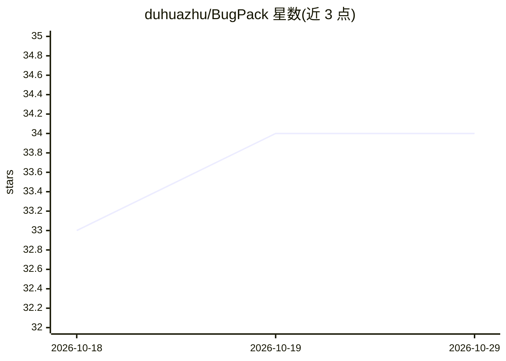

# duhuazhu/BugPack

⭐ 34 · TypeScript · MIT · 推送 2026-10-17 · [GitHub](https://github.com/duhuazhu/BugPack) · [官网](https://www.npmjs.com/package/bugpack-mcp) · 个人维护 · 中文 README

**将 bug 截图打包为 AI 修复指令的本地工具（含 MCP Server）**

面向开发者的本地 bug 上下文管理工具：粘贴或拖入 bug 截图，使用 9 种标注工具与对比模式标注问题，一键生成结构化 Markdown 修复指令供 AI 编码代理使用；内置 MCP Server，提供 list_bugs、get_bug_context、mark_bug_status 等工具，使 Claude Code、Cursor、Windsurf、Cline 等 MCP 兼容工具可直接读取 bug 上下文并修复代码。支持从禅道、Jira、Linear、TAPD 导入 bug 并回同步状态。数据以 SQLite 全本地存储，另提供 3 个 OpenClaw Skills。需 Node.js ≥ 18 与浏览器，通过 npx 运行。

## 筛选速览

| 维度 | 判定 | 备注 |
|---|---|---|
| AI 角色 | `ai-ecosystem` | LLM/agent 周边工具 |
| 许可风险 | `permissive` | MIT |
| 部署形态 | `library` | 以包/库形式分发 |
| 模型依赖 | — | README 未给出锁定关系 |
| 硬件要求 | — | 无带数字的原话,不猜 |
| 安装摩擦 | `low` | 无编译、无系统依赖或容器化 |
| 成熟度 | — | 结构信号不足 |

## 能力要点

- 剪贴板粘贴截图与 9 种标注工具、当前/预期对比模式
- 内置 MCP Server，提供 5 个工具供 AI 编码代理读取 bug 上下文并修复
- 一键生成结构化 Markdown 修复指令
- 从禅道/Jira/Linear/TAPD 导入 bug 并同步修复状态

## 适用场景

- 把聊天里的 bug 截图快速标注并交给 AI 编码代理修复
- 让 Claude Code/Cursor 等工具通过 MCP 直接读取待修 bug 列表与上下文
- 本地多项目管理 bug，数据不出机器

## 场景标签

 · 领域:开发工具/缺陷管理

## 证据(README 行号)

> L24: Or skip the copy-paste entirely: BugPack's built-in **MCP Server** lets any MCP-compatible AI coding tool (Claude C

## 星数曲线

2026-10-18 33 → 2026-10-29 34（+1）

---
*卡片 v1 · prompt 1.4 · 生成 2026-10-25 · 置信度 high · 依据 README sha `c55c5d6cef13` · [字段定义](../../DATASET.md)*
