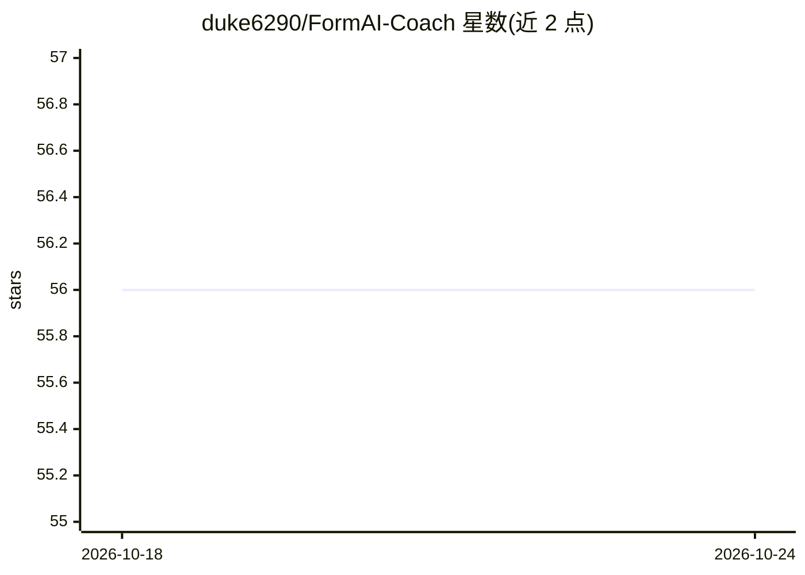

# duke6290/FormAI-Coach

⭐ 56 · HTML · 推送 2026-10-23 · [GitHub](https://github.com/duke6290/FormAI-Coach) · 个人维护

**AI 动作姿态教练：用姿态估计实时评估与纠正训练动作**

面向运动员、康复患者、舞者与远程教练的实时动作姿态分析应用：通过摄像头画面做姿态估计，检测关节角度、左右对称性与离心/向心/等长阶段节奏，生成文字或语音的教练提示；支持危险姿态预警、按表现动态规划后续训练、本地存储训练记录与多语言无障碍界面。技术栈为 JS/TS 客户端加 Node 服务层，本地优先存储。README 未给出具体安装或运行命令，功能多为规划性描述（Roadmap 至 2026-2027）。

## 筛选速览

| 维度 | 判定 | 备注 |
|---|---|---|
| AI 角色 | `ai-native` | 本体是模型或模型工具 |
| 许可风险 | `none` | — |
| 部署形态 | `None` |  |
| 模型依赖 | — | README 未给出锁定关系 |
| 硬件要求 | — | 无带数字的原话,不猜 |
| 安装摩擦 | `low` | 无编译、无系统依赖或容器化 |
| 成熟度 | — | 结构信号不足 |

## 能力要点

- 摄像头实时姿态估计与关节轨迹识别（宣称最高 60fps）
- 左右对称性检测与阶段节奏（离心/向心/等长）分析
- 危险关节姿态预警与离线核心反馈
- 康复模板可由临床人员自定义，本地存储不上传视频

## 适用场景

- 独自训练时获得深蹲、卧推等动作的实时纠正提示
- 康复期按临床模板做步态或肩部旋转再训练
- 教练远程查看多客户动作标注并分享反馈

## 场景标签

`图像视频处理` · 领域:感知与多模态

## 证据(README 行号)

> L14: This repository houses the complete architecture of the Sanctuary: a real-time pose estimation engine, a procedural
> L38: - **Real-Time Pose Cartography** — A dense skeletal mesh is reconstructed from your camera feed at up to 60 frames 

## 星数曲线

2026-10-18 56 → 2026-10-24 56（+0）

---
*卡片 v1 · prompt 1.4 · 生成 2026-10-24 · 置信度 mid · 依据 README sha `3cba850a9110` · [字段定义](../../DATASET.md)*
