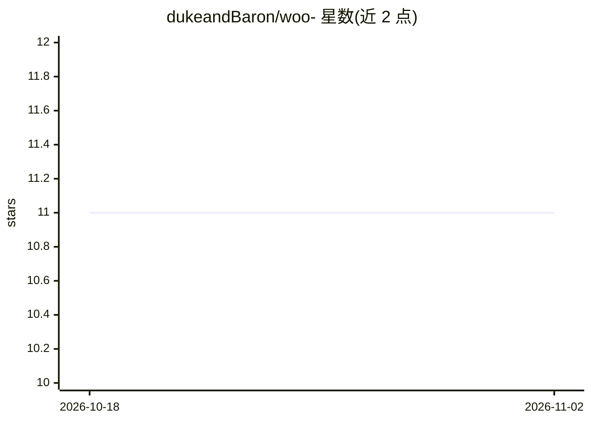

# dukeandBaron/woo-

⭐ 11 · Python · Apache-2.0 · 推送 2026-10-31 · [GitHub](https://github.com/dukeandBaron/woo-) · [官网](https://dukeandbaron.github.io/woo-/) · 组织维护 · 中文 README

**工业视觉数据的治理与发布门禁 Agent，证据先行、失败即关闭**

面向工业视觉团队（算法工程师、方案商、质量负责人）的数据治理系统：在图像采集、标注与模型训练交付之间管理数据版本的准入与整改。机制上采用确定性测量工具 + 受控 Agent 补证（Worker 选择、竞争假设、预算约束）+ 具名人员批准的 Parent–CAPA–Child 闭环，Parent 版本只读，Child Run 独立复验；生产放行固定为 false，Fail-Closed。技术栈含 React/Tauri 工作台、Spring WebFlux 网关、FastAPI、SQLite。本地运行需 Python 3.12/3.13、uv、Node.js 22.12+；提供未签名的 Windows prerelease 候选，第三方复现状态为 PENDING。

## 筛选速览

| 维度 | 判定 | 备注 |
|---|---|---|
| AI 角色 | `ai-ecosystem` | LLM/agent 周边工具 |
| 许可风险 | `permissive` | Apache-2.0 |
| 部署形态 | `None` |  |
| 模型依赖 | — | README 未给出锁定关系 |
| 硬件要求 | — | 无带数字的原话,不猜 |
| 安装摩擦 | `low` | 无编译、无系统依赖或容器化 |
| 成熟度 | `idea` | |

## 能力要点

- 确定性工具 + 受控 Agent + 具名人员批准的三方分工治理闭环
- Parent 只读、Derived Version 整改、Child Run 同合同独立复验
- Fail-Closed：证据不足/审批缺失时保持 HOLD，生产放行固定为 false
- 证据记忆需通过来源、版本一致性、授权范围六重校验后方可检索

## 适用场景

- 换型补采、标注返修后判断数据是否具备交付条件
- 质量负责人对整改结果逐项对账并作出具名放行决定
- 为视觉模型训练维护可复算、有血缘的数据候选版本

## 场景标签

 · 领域:工业 AI/数据治理

## 证据(README 行号)

> L19: VisionData Gate 位于工业图像采集、标注与模型训练交付之间，管理每一版数据进入下一步前的证据条件。缺陷识别由下游模型完成；本系统负责数据版本、问题处置、人员责任和复验结果能否对账。
> L22:  治理 确定性测量、Agent 补证、人工批准和 Child Run
> L141: 系统采用一个受控 Agent 内核、两条版本化闭环和一套共享证据底座。数据治理闭环负责数据准入与整改复验；模型开发闭环负责可选训练、独立评测和人工分类后的反馈回流。

## 星数曲线

2026-10-18 11 → 2026-11-02 11（+0）

---
*卡片 v1 · prompt 1.4 · 生成 2026-11-02 · 置信度 high · 依据 README sha `a6c8cfacdaa7` · [字段定义](../../DATASET.md)*
