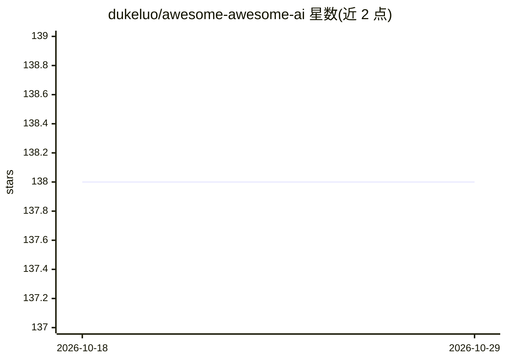

# dukeluo/awesome-awesome-ai

⭐ 138 · MIT · 推送 2026-10-25 · [GitHub](https://github.com/dukeluo/awesome-awesome-ai) · 个人维护 · 中文 README

**AI 清单的清单：聚合各 AI 主题 awesome list 的导航目录**

一个元级策展清单（awesome list of awesome lists），收集与 AI 相关的各类资源清单并按主题分类：AI 编程与 Agent、AI 目录、LLM 与平台、Prompt 工程、Prompt 库等。每个条目给出所收录清单的名称、简介、Stars 与最近提交时间，并标注最后审计日期。面向想系统性查找 AI 学习资源、工具与 prompt 资料的开发者和学习者，本身不提供软件安装，仅以 Markdown 目录形式阅读使用。

## 筛选速览

| 维度 | 判定 | 备注 |
|---|---|---|
| AI 角色 | `ai-knowledge` | 知识聚合/清单类 |
| 许可风险 | `permissive` | MIT |
| 部署形态 | `None` |  |
| 模型依赖 | — | README 未给出锁定关系 |
| 硬件要求 | — | 无带数字的原话,不猜 |
| 安装摩擦 | `low` | 无编译、无系统依赖或容器化 |
| 成熟度 | — | 结构信号不足 |

## 能力要点

- 元级聚合：收录 AI 相关的 awesome list 而非单个工具
- 按 AI Coding & Agents、LLMs & Platforms、Prompt Engineering 等主题分类
- 条目附 Stars 与 Last Commit 元数据，含最后审计日期

## 适用场景

- 系统浏览 AI 各子领域的优质资源清单
- 查找 prompt 工程教程与 prompt 库的入口
- 了解 AI 编程与 Agent 相关的策展资源

## 场景标签

`精选清单` · 领域:学习与行业

## 证据(README 行号)

> L7: An awesome list for collecting awesome lists related to AI.
> L9: ## Contents

## 星数曲线

2026-10-18 138 → 2026-10-29 138（+0）

---
*卡片 v1 · prompt 1.4 · 生成 2026-10-22 · 置信度 high · 依据 README sha `edab2384ee3e` · [字段定义](../../DATASET.md)*
