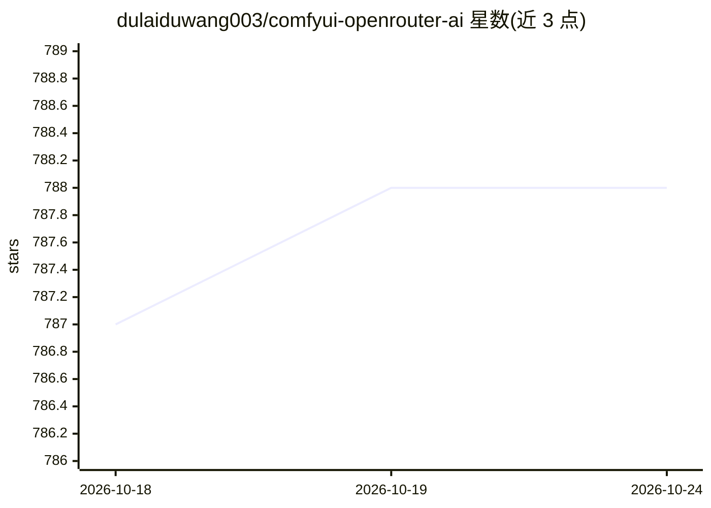

# dulaiduwang003/comfyui-openrouter-ai

⭐ — · [GitHub]() · 个人维护 · 中文 README

**ComfyUI 工作流与 LLM 聊天的一体化自托管管理平台**

前后端分离的全栈项目：后端为 Spring Boot 3 多模块架构（Maven），前端为 Vue 3 + Vite + TypeScript。功能包括基于 Sa-Token 的账号鉴权、集成 OpenRouter 的多模型 SSE 流式聊天、ComfyUI 工作流的表单化参数收集与任务提交（支持多 ComfyUI 服务、超时重试）、阿里云 OSS 对象存储、邮件通知，以及用户/积分/兑换码等后台管理。需 JDK 21+、Maven、Node.js、MySQL、Redis 自行构建部署，提供传统服务器、Docker、K8s 部署文档链接。

## 筛选速览

| 维度 | 判定 | 备注 |
|---|---|---|
| AI 角色 | `ai-ecosystem` | LLM/agent 周边工具 |
| 许可风险 | `permissive` | — |
| 部署形态 | `library` | 以包/库形式分发 |
| 模型依赖 | locked-api |  |
| 硬件要求 | — | 无带数字的原话,不猜 |
| 安装摩擦 | `medium` | 含编译或系统依赖之一 |
| 成熟度 | — | 结构信号不足 |

## 能力要点

- ComfyUI 工作流表单化编排，支持多 ComfyUI 服务与任务超时重试
- OpenRouter 多模型注册与 SSE 流式聊天
- 用户/积分/兑换码/公告等后台管理系统
- 阿里云 OSS 对象存储与全局文件类型/大小白名单

## 适用场景

- 自建 AI 图像生成平台并管理 ComfyUI 工作流与模型任务
- 搭建带积分与用户系统的 AI 创作/聊天服务
- 为团队或社区提供统一的 ComfyUI 服务入口与负载分发

## 场景标签

`图像生成` `聊天机器人` · 领域:对话与助手

## 证据(README 行号)

> L18: 面向 AI 创作与工作流的全栈开源项目：前端基于 Vue 3 + Vite + TypeScript + Element Plus，后端采用 Spring Boot 3 多模块架构，集成登录鉴权、聊天（LLM/OpenRouter
> L41: - **ComfyUI 工作流**: 表单化参数收集、任务提交与状态订阅、任务超时与重试策略、文件类型白名单、支持配置多个Comfyui服务、(提交任务、取消任务、重新制作)。

## 星数曲线

2026-10-18 787 → 2026-10-24 788（+1）

---
*卡片 v1 · prompt 1.4 · 生成 2026-10-21 · 置信度 high · 依据 README sha `3255cc0e347d` · [字段定义](../../DATASET.md)*
