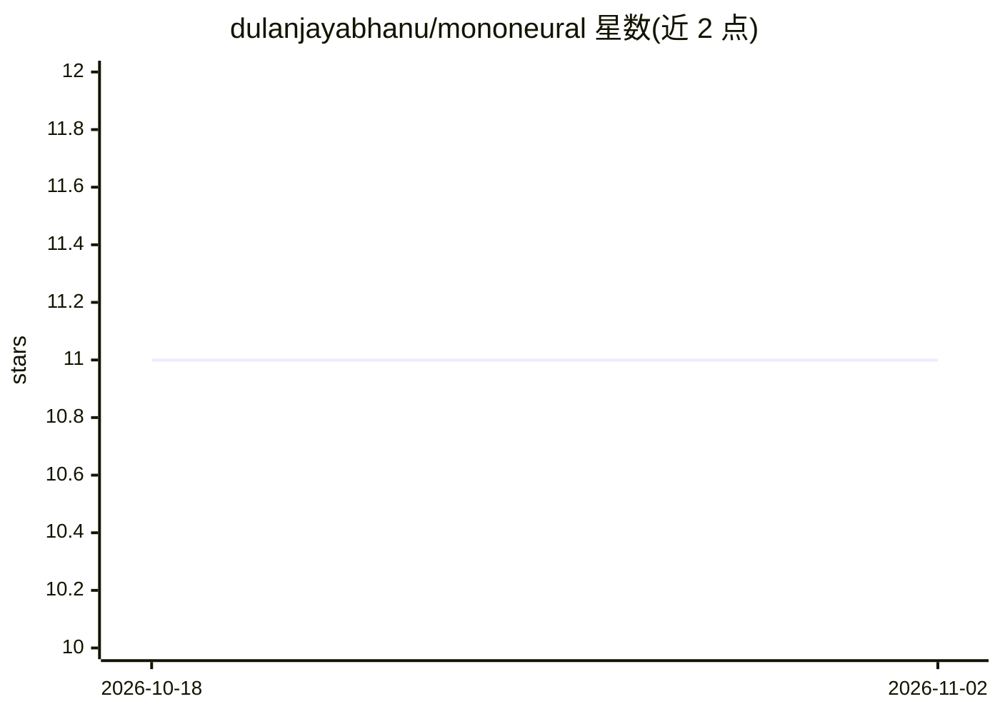

# dulanjayabhanu/mononeural

⭐ 11 · TypeScript · MIT · 推送 2026-10-25 · [GitHub](https://github.com/dulanjayabhanu/mononeural) · [官网](https://mononeural.vercel.app/) · 个人维护

**可视化搭建人工神经元并实时训练测试的教学平台**

面向无编程基础学习者的神经网络教学 Web 应用：用户以图形界面构造人工神经元、定义输入、配置权重与偏置，实时观察参数对加权求和、激活输出与预测的影响；提供训练器、测试器、预训练示例与渐进式文档四大模块。测试器支持配置预测阈值将数值输出转译为可读结论。技术栈为 React + TypeScript + Vite，神经元可视化使用 React Flow，提供在线部署版本，也可从源码运行。

## 筛选速览

| 维度 | 判定 | 备注 |
|---|---|---|
| AI 角色 | `ai-native` | 本体是模型或模型工具 |
| 许可风险 | `permissive` | MIT |
| 部署形态 | `library` | 以包/库形式分发 |
| 模型依赖 | — | README 未给出锁定关系 |
| 硬件要求 | — | 无带数字的原话,不猜 |
| 安装摩擦 | `low` | 无编译、无系统依赖或容器化 |
| 成熟度 | — | 结构信号不足 |

## 能力要点

- 图形化构造神经元并实时可视化权重/偏置对预测的影响
- 训练器支持自定义数据集与迭代训练流程
- 测试器支持可配置预测阈值与结果转译
- 内置预训练示例（学业预测、金融决策等场景）

## 适用场景

- 不写代码直观理解神经元参数如何影响预测
- 教学中演示训练、测试与泛化概念
- 通过预训练示例快速了解神经元决策场景

## 场景标签

`教程课程` · 领域:学习与行业

## 证据(README 行号)

> L13: MonoNeural is an interactive learning platform designed to simplify the core concepts of artificial neural networks
> L71: The Artificial Neuron Trainer is the core learning component of MonoNeural. It allows users to construct a neuron f

## 星数曲线

2026-10-18 11 → 2026-11-02 11（+0）

---
*卡片 v1 · prompt 1.4 · 生成 2026-11-02 · 置信度 high · 依据 README sha `ee821f193126` · [字段定义](../../DATASET.md)*
