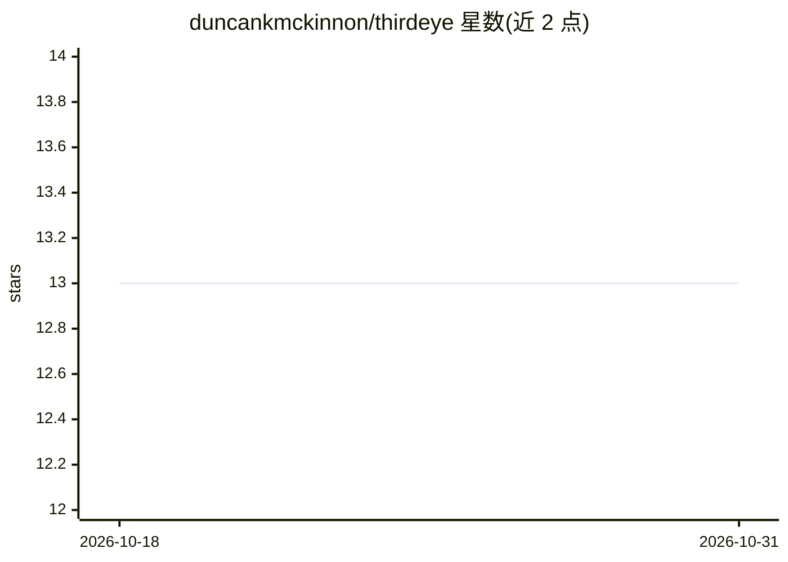

# duncankmckinnon/thirdeye

⭐ 13 · Python · MIT · 推送 2026-10-29 · [GitHub](https://github.com/duncankmckinnon/thirdeye) · [官网](https://third3y3.com/) · 个人维护

**将本机编码 agent 会话追踪为持久历史并导出 Logfire**

面向使用 Claude Code、Codex、Cursor、Copilot 等编码 agent 的开发者：thirdeye把每个 agent 会话持久化为本地追加式事件历史，记录提示、响应、工具调用、子 agent、用量与会话元数据，进程退出后仍可检查。通过向导式 setup 安装钩子与 agent 配置，可选连接 Pydantic Logfire，把数据导出为 OpenTelemetry trace，用于浏览执行树、跨会话查询与分析 token 花费；导出发生在钩子之外，网络延迟不中断会话。内置 5 个 agent 技能（检查/评测/审计/过滤/Logfire 配置）。macOS/Linux 经 Homebrew 安装，Windows 用 pipx/uv。

## 筛选速览

| 维度 | 判定 | 备注 |
|---|---|---|
| AI 角色 | `ai-ecosystem` | LLM/agent 周边工具 |
| 许可风险 | `permissive` | MIT |
| 部署形态 | `library` | 以包/库形式分发 |
| 模型依赖 | — | README 未给出锁定关系 |
| 硬件要求 | — | 无带数字的原话,不猜 |
| 安装摩擦 | `low` | 无编译、无系统依赖或容器化 |
| 成熟度 | — | 结构信号不足 |

## 能力要点

- 会话持久化为本地追加式事件历史，进程退出后仍可查询
- 导出为 OpenTelemetry trace 至 Pydantic Logfire，含 token 用量与成本
- 导出在 agent 钩子外执行，网络延迟不中断会话
- 内置 use-thirdeye/evals/review/filter/logfire 五个 agent 技能

## 适用场景

- 我想保留并检索所有编码 agent 会话的完整历史
- 在 Logfire 中跨会话分析 agent 行为与 token 花费
- 让 agent 自己读取历史来调试工具调用或做评测审计

## 场景标签

`LLM 可观测性` `Agent 记忆` · 领域:Agent 开发

## 证据(README 行号)

> L12: Trace every agent session on your machine — Claude Code, Codex, Cursor, Copilot —
> L18: a consistent record to inspect. Connect thirdeye to Pydantic Logfire to make
> L65: Pydantic Logfire is where thirdeye's captured

## 星数曲线

2026-10-18 13 → 2026-10-31 13（+0）

---
*卡片 v1 · prompt 1.4 · 生成 2026-10-31 · 置信度 high · 依据 README sha `49cc14105fc0` · [字段定义](../../DATASET.md)*
