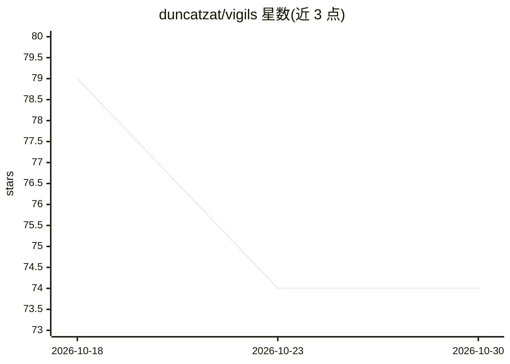

# duncatzat/vigils

⭐ 74 · Rust · Apache-2.0 · 推送 2026-09-17 · [GitHub](https://github.com/duncatzat/vigils) · [官网](https://vigils.ai) · 个人维护 · 中文 README

**AI agent 本地控制平面：审计、审批、防泄密与沙箱**

位于 AI agent 与其工具/数据之间的本地优先控制平面，覆盖 Claude Code、Codex、Cursor 等多种 agent。核心机制：SHA-256 哈希链防篡改审计账本（SQLite+FTS5）、默认拒绝的防火墙策略 DSL、人工审批队列、秘密/PII 脱敏引擎（硬指纹规则或可选 ML 集成）、一次性沙箱执行（Wasm/Linux Landlock）以及 MCP 网关。提供 CLI（一键安装脚本）、Tauri 桌面应用与 Chrome MV3 扩展；所有数据留在本机。早期版本未经操作系统代码签名，首次运行会弹出安全提示。

## 筛选速览

| 维度 | 判定 | 备注 |
|---|---|---|
| AI 角色 | `ai-ecosystem` | LLM/agent 周边工具 |
| 许可风险 | `permissive` | Apache-2.0 |
| 部署形态 | `desktop` | 安装包/桌面程序 |
| 模型依赖 | — | README 未给出锁定关系 |
| 硬件要求 | — | 无带数字的原话,不猜 |
| 安装摩擦 | `low` | 无编译、无系统依赖或容器化 |
| 成熟度 | — | 结构信号不足 |

## 能力要点

- SHA-256 哈希链防篡改审计账本，支持全文搜索
- 默认拒绝防火墙 + 人工审批队列（可按作用域授权）
- 17+ 类凭证的硬指纹脱敏，可选 OpenAI PII NER + DeBERTa ML 集成
- MCP 网关（stdio/HTTP）与桌面应用一键为全机 agent 接入防护

## 适用场景

- 在 agent 调用工具前拦截破坏性或敏感操作并人工审批
- 记录可验证的完整工具调用审计日志
- 防止 API 密钥等凭证进入提示词、日志或浏览器粘贴

## 场景标签

`网络安全` · 领域:学习与行业

## 证据(README 行号)

> L16: **Vigils sits between your agents and the tools/data they touch**, and it is *local-first*:
> L20:    AI agent ──▶  ┌─────────────────── Vigils ───────────────────┐  ──▶  tools / data
> L57: - **🔌 MCP gateway** — sits in front of MCP servers over **stdio and HTTP**; descriptor

## 星数曲线

2026-10-18 79 → 2026-10-30 74（-5）

---
*卡片 v1 · prompt 1.4 · 生成 2026-10-24 · 置信度 high · 依据 README sha `adc7bbefebb9` · [字段定义](../../DATASET.md)*
