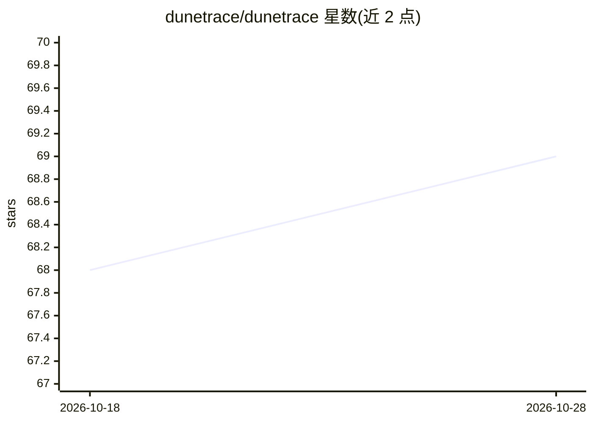

# dunetrace/dunetrace

⭐ 69 · Python · NOASSERTION · 推送 2026-09-20 · [GitHub](https://github.com/dunetrace/dunetrace) · [官网](https://dunetrace.com/) · 组织维护

**AI agent 运行时可靠性层：检测、阻断与修复 agent 故障**

面向 AI agent 开发者的监控与可靠性平台：通过 Python/TypeScript SDK 埋点记录会话、工具调用与 LLM 交换；提供 34 个零 LLM 结构化检测器（工具循环、重试风暴、记忆投毒、委托环等），在请求路径内以策略（policy）在执行前阻断或降级运行；可选的 LLM 语义评估（DeepEval 支持的 7 个评估器，事后采样）。告警支持 Slack 与 webhook，并对告警做根因分析与一键修复（运行时策略或草稿 PR）。后端以 Docker Compose 部署，共享单个 Postgres，核心管线无需 LLM key；另提供 MCP server 供 Claude Code/Cursor/Codex 查询信号。

## 筛选速览

| 维度 | 判定 | 备注 |
|---|---|---|
| AI 角色 | `ai-ecosystem` | LLM/agent 周边工具 |
| 许可风险 | `permissive` | NOASSERTION |
| 部署形态 | `self-host` | docker 或自建部署 |
| 模型依赖 | — | README 未给出锁定关系 |
| 硬件要求 | — | 无带数字的原话,不猜 |
| 安装摩擦 | `low` | 无编译、无系统依赖或容器化 |
| 成熟度 | — | 结构信号不足 |

## 能力要点

- 34 个零 LLM 结构化检测器，其中 31 个在请求路径内（单 hook <500μs）
- 运行时策略可在执行前 stop/switch_model/escalate/inject 阻断故障
- 根因分析输出运行时策略自动应用或一键草稿 PR，并跟踪修复效果
- MCP server 提供 31 个工具，可在编辑器内查询 agent 信号

## 适用场景

- 生产环境实时发现 agent 的静默失败（工具循环、记忆投毒、截断滥用等）
- 在请求路径上用策略阻断失控运行而非事后排查
- 为 LangChain/CrewAI/AutoGen 等框架的 agent 统一接入监控与告警

## 场景标签

`LLM 可观测性` · 领域:评测与运维

## 证据(README 行号)

> L5: **Runtime reliability for AI agents. Structural and semantic detection, runtime prevention, native root cause, and o
> L43: |2|**Structural Detection**|34 zero-LLM detectors (31 of them in-path, sub-500μs per hook) — the always-on first li

## 星数曲线

2026-10-18 68 → 2026-10-28 69（+1）

---
*卡片 v1 · prompt 1.4 · 生成 2026-10-24 · 置信度 high · 依据 README sha `e8f04ae6d258` · [字段定义](../../DATASET.md)*
