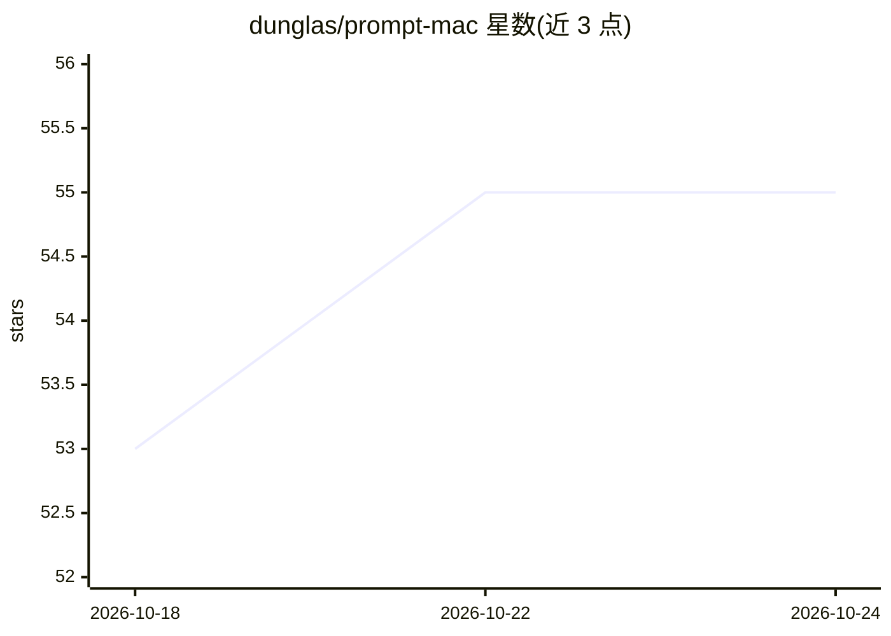

# dunglas/prompt-mac

⭐ 55 · Shell · MIT · 推送 2026-07-29 · [GitHub](https://github.com/dunglas/prompt-mac) · [官网](https://dunglas.dev) · 个人维护

**Apple Silicon macOS 一键初始化脚本，面向 AI 编码工作流**

由 Kévin Dunglas（FrankenPHP/API Platform 作者）维护的个人化 one-shot 配置脚本：通过 curl 一行命令在全新 Mac 上安装 CLI 工具、应用与编辑器配置，全部条目由 Brewfile 显式管理，脚本幂等可重复运行。核心面向 coding-agent 工作流：预装 Claude、Claude Code、cmux 组成的 agent 栈；同时配置 Ghostty/Neovim/zsh 环境、多语言运行时、colima+docker 容器与 k3s 本地 Kubernetes。配置文件以符号链接方式映射到系统位置，修改仓库内文件即时生效。

## 筛选速览

| 维度 | 判定 | 备注 |
|---|---|---|
| AI 角色 | `ai-enhanced` | 去掉 AI 部分产品仍成立 |
| 许可风险 | `permissive` | MIT |
| 部署形态 | `self-host` | docker 或自建部署 |
| 模型依赖 | — | README 未给出锁定关系 |
| 硬件要求 | — | 无带数字的原话,不猜 |
| 安装摩擦 | `low` | 无编译、无系统依赖或容器化 |
| 成熟度 | — | 结构信号不足 |

## 能力要点

- curl 一行命令完成全新 Mac 初始化，脚本幂等可重复执行
- 预装 Claude / Claude Code / cmux 组成的 AI agent 工作栈
- colima 管理 docker 运行时，colima start --kubernetes 可启动本地 k3s 集群
- Brewfile 显式管理全部安装条目，配置文件符号链接即时生效

## 适用场景

- 新 Mac 开箱后一条命令搭好 AI 编码开发环境
- 需要本地 Docker 与 Kubernetes 沙箱的前端/后端开发
- 用 cmux 并行运行和监控多个 AI 编码 agent

## 场景标签

 · 领域:开发环境/DevOps 工具

## 证据(README 行号)

> L14: That's why I built `prompt-mac`. It's my personal, highly opinionated, one-shot setup script for **Apple Silicon ma
> L47: * 🤖 **AI-first, out of the box.** A dedicated agent stack (Claude, Claude Code, cmux) is wired in from the start.

## 星数曲线

2026-10-18 53 → 2026-10-24 55（+2）

---
*卡片 v1 · prompt 1.4 · 生成 2026-10-24 · 置信度 mid · 依据 README sha `29c29443ab82` · [字段定义](../../DATASET.md)*
