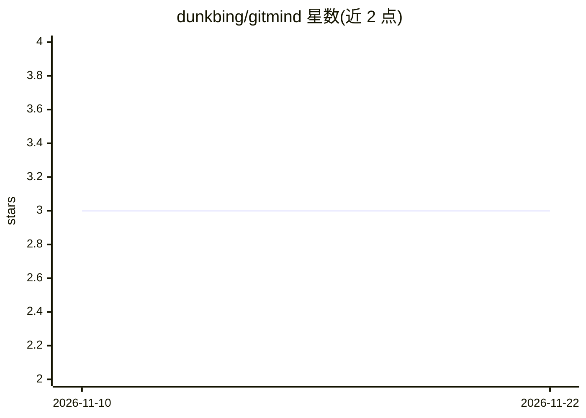

# dunkbing/gitmind

⭐ 3 · Go · 推送 2026-11-21 · [GitHub](https://github.com/dunkbing/gitmind) · [官网](https://gitmind.app) · 个人维护

**为编码 agent 提供基于 git 的共享记忆的 MCP 服务器**

用 Go 编写的本地 stdio MCP 服务器，为多个 AI 应用（claude.ai、ChatGPT、Claude Code、Codex）提供统一记忆层：agent 在工作过程中保存决策、偏好、配置等笔记（Markdown 存于 git 仓库），并在下个会话开始时读取。核心机制包括会话启动 hook 加载上下文、停止前 nudge 提醒保存、事实变更转历史归档、冲突警告与 git union 合并、API key 写入拦截。支持 gitmind.app 托管、GitHub 私有仓库同步或本地模式；提供全文本搜索（SQLite FTS5/BM25）、Claude Code 记忆导入、Obsidian 兼容的笔记格式。

## 筛选速览

| 维度 | 判定 | 备注 |
|---|---|---|
| AI 角色 | `ai-ecosystem` | LLM/agent 周边工具 |
| 许可风险 | `none` | — |
| 部署形态 | `library` | 以包/库形式分发 |
| 模型依赖 | — | README 未给出锁定关系 |
| 硬件要求 | — | 无带数字的原话,不猜 |
| 安装摩擦 | `low` | 无编译、无系统依赖或容器化 |
| 成熟度 | — | 结构信号不足 |

## 能力要点

- 一个 MCP 端点连通 claude.ai、ChatGPT、Claude Code 与 Codex，跨设备共享记忆
- 笔记为自有 git 仓库中的 Markdown，可在 Obsidian 中查看编辑
- SessionStart/nudge 双 hook 实现记忆自动加载与保存
- supersede 机制将变更事实按日期归档到 History 并警告冲突

## 适用场景

- 让多个 AI 编码工具共享同一份项目决策与偏好记忆
- 每个会话自动带上项目上下文，免去重复说明
- 把 agent 学到的经验沉淀为可离线阅读的 Markdown 知识库

## 场景标签

`知识库管理` `Agent 记忆` · 领域:Agent 开发

## 证据(README 行号)

> L12: - **Works in every AI app**: one MCP endpoint for claude.ai, ChatGPT, Claude
> L32: Each machine runs `gitmind` as a local stdio MCP server. There is no central
> L46: Cloudflare (AGPL-3.0): the same memory over a remote MCP endpoint for

## 星数曲线

2026-11-10 3 → 2026-11-22 3（+0）

---
*卡片 v1 · prompt 1.4 · 生成 2026-11-22 · 置信度 high · 依据 README sha `1a58246edf65` · [字段定义](../../DATASET.md)*
