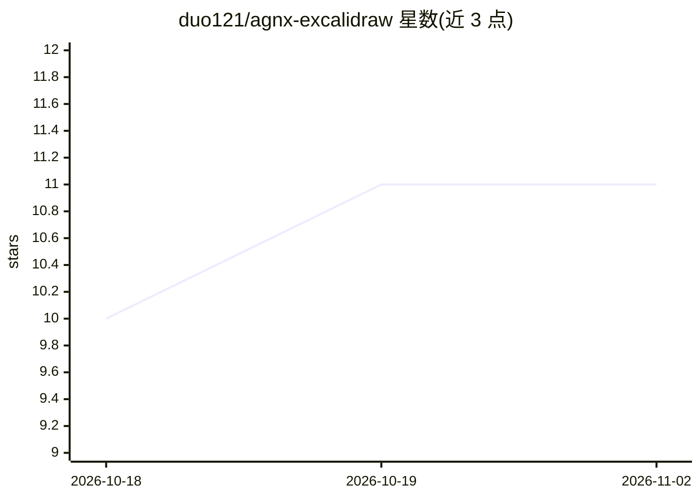

# duo121/agnx-excalidraw

⭐ 11 · TypeScript · MIT · 推送 2026-01-13 · [GitHub](https://github.com/duo121/agnx-excalidraw) · [官网](https://agnx-excalidraw.vercel.app) · 个人维护 · 中文 README

**AI 增强的 Excalidraw 白板：对话生成 Mermaid 并转为图形**

基于 Excalidraw 的白板应用：保留全部绘图能力，并集成 AI 聊天面板，用户以自然语言描述（如用户登录流程图），AI 生成 Mermaid 代码后自动转换为 Excalidraw 图形；也可手动输入 Mermaid 代码转换，支持流程图、时序图、类图等 6 类图。AI 侧支持 OpenAI、Anthropic、Gemini、DeepSeek 及 iFlow 免费模型（GLM-4-Air、Kimi K2）。技术栈为 React 19 + TypeScript + Vite 7，提供 Vercel 一键部署与 pnpm 本地开发流程，图自动保存到浏览器本地存储。

## 筛选速览

| 维度 | 判定 | 备注 |
|---|---|---|
| AI 角色 | `ai-enhanced` | 去掉 AI 部分产品仍成立 |
| 许可风险 | `permissive` | MIT |
| 部署形态 | `None` |  |
| 模型依赖 | locked-api |  |
| 硬件要求 | — | 无带数字的原话,不猜 |
| 安装摩擦 | `low` | 无编译、无系统依赖或容器化 |
| 成熟度 | — | 结构信号不足 |

## 能力要点

- 自然语言生成 Mermaid 代码并转换为 Excalidraw 图形
- 支持 OpenAI/Anthropic/Gemini/DeepSeek 及 iFlow 免费模型（GLM-4-Air、Kimi K2）
- 6 种 Mermaid 图类型转换，图自动保存到浏览器本地存储
- Vercel 一键部署

## 适用场景

- 通过对话快速生成流程图、时序图等白板图形
- 在白板中直接编辑和转换 Mermaid 代码
- 无 API key 时使用 iFlow 免费模型体验 AI 功能

## 场景标签

`代码生成` · 领域:编码与开发

## 证据(README 行号)

> L5: An AI-enhanced whiteboard application based on Excalidraw, supporting Mermaid diagram conversion and multiple AI mod
> L88: 3. AI will generate Mermaid code and convert it to Excalidraw graphics
> L39: - 🤖 **AI Chat** - Support for multiple AI models (OpenAI, Anthropic, Gemini, iFlow free models, etc.)

## 星数曲线

2026-10-18 10 → 2026-11-02 11（+1）

---
*卡片 v1 · prompt 1.4 · 生成 2026-11-02 · 置信度 high · 依据 README sha `237965a85347` · [字段定义](../../DATASET.md)*
