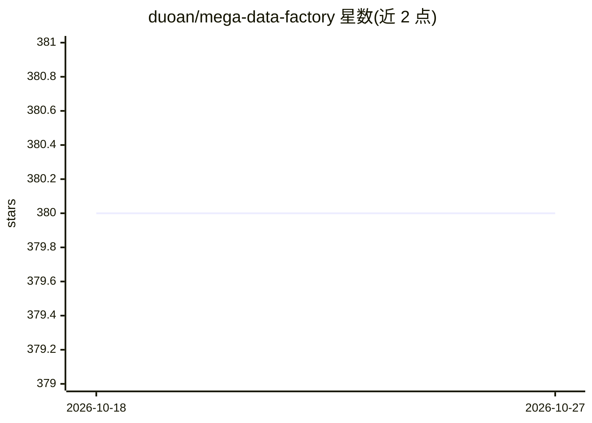

# duoan/mega-data-factory

⭐ 380 · Python · MIT · 推送 2026-05-12 · [GitHub](https://github.com/duoan/mega-data-factory) · 个人维护

**复现 SOTA 基座模型数据管线的分布式多模态处理框架**

基于 Ray 构建的分布式数据流水线框架，面向网页级（千亿级）文本、图像、视频多模态数据集的清洗、打分与去重，目标是复现 FineWeb、RefinedWeb、LAION-5B、DataComp 等 SOTA 基座模型数据管线。提供 Rust 加速与 GPU 优化的算子（URL 过滤、启发式质量过滤、CLIP/SigLIP 嵌入、感知哈希去重等），支持 YAML 配置驱动整条管线，并通过在线 API/账号池或本地 vLLM 离线推理进行 LLM 合成。构建加速算子需要 Rust 工具链。

## 筛选速览

| 维度 | 判定 | 备注 |
|---|---|---|
| AI 角色 | `ai-ecosystem` | LLM/agent 周边工具 |
| 许可风险 | `permissive` | MIT |
| 部署形态 | `library` | 以包/库形式分发 |
| 模型依赖 | local-ok | 支持本地模型 |
| 硬件要求 | — | 无带数字的原话,不猜 |
| 安装摩擦 | `medium` | 含编译或系统依赖之一 |
| 成熟度 | — | 结构信号不足 |

## 能力要点

- 复现 FineWeb/RefinedWeb/LAION-5B/DataComp 等论文数据管线，含实现状态跟踪
- Rust 加速（图像质量、哈希、HTML 提取）与 GPU 优化的 CLIP/SigLIP 嵌入算子
- 桶式分布式去重支持 100B+ 键，Ray 流水线并行与背压控制
- LLM 合成算子支持在线 API（账号池/代理池）与本地 vLLM 离线批量推理

## 适用场景

- 构建大规模预训练语料的清洗、过滤与去重管线
- 图像数据集做质量打分、AIGC 检测与感知哈希去重
- 复现论文中的 SOTA 数据管线做数据消融实验

## 场景标签

`模型训练` `MLOps` · 领域:训练与推理

## 证据(README 行号)

> L3: A reproducible, high-throughput, distributed open-source pipeline for processing web-scale (hundreds of billions) mu
> L11: **Reproduce SOTA foundation model data pipelines** — from rule-based to model-based, spanning text, image, and mult
> L337: - **Pipeline Parallelism**: Ray ObjectRef chaining enables concurrent stage execution without blocking (details)

## 星数曲线

2026-10-18 380 → 2026-10-27 380（+0）

---
*卡片 v1 · prompt 1.4 · 生成 2026-10-21 · 置信度 high · 依据 README sha `f132cb8f1790` · [字段定义](../../DATASET.md)*
