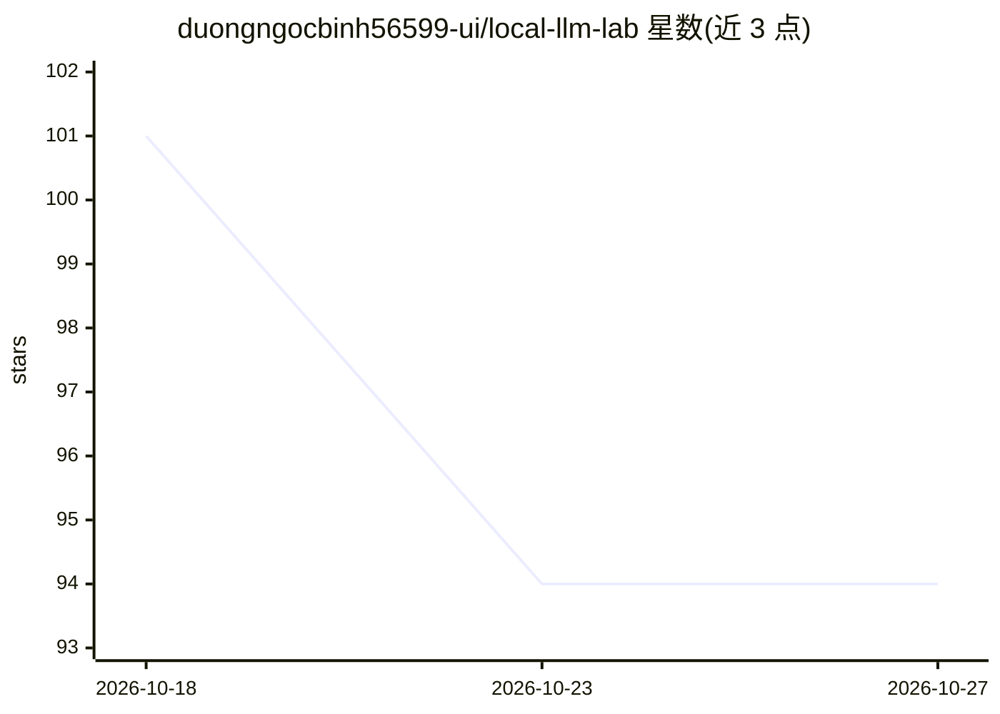

# duongngocbinh56599-ui/local-llm-lab

⭐ 94 · Python · MIT · 推送 2026-09-19 · [GitHub](https://github.com/duongngocbinh56599-ui/local-llm-lab) · 个人维护

**本地 LLM 部署规划与基准测试 CLI，判断模型能否装进内存**

面向 64GB-256GB 统一内存机器（尤其 Apple Silicon）开发者的 Python CLI：检测本地硬件、按显式公式估算模型权重/KV cache/开销并给出 fits/no-fit 判定与风险，比较量化/上下文/后端组合并推荐方案，生成 llama.cpp/MLX/Ollama 干跑脚本（不下载权重），支持 mock 基准、资源争用压力模拟与 Markdown/JSON/SVG/HTML 报告。核心 CLI 无第三方必装依赖；Linux+NVIDIA 支持为未来扩展路径。

## 筛选速览

| 维度 | 判定 | 备注 |
|---|---|---|
| AI 角色 | `ai-ecosystem` | LLM/agent 周边工具 |
| 许可风险 | `permissive` | MIT |
| 部署形态 | `library` | 以包/库形式分发 |
| 模型依赖 | local-ok | 支持本地模型 |
| 硬件要求 | — | 无带数字的原话,不猜 |
| 安装摩擦 | `medium` | 含编译或系统依赖之一 |
| 成熟度 | `idea` | |

## 能力要点

- 显式可检查的内存估算公式（权重+KV cache+开销+OS 预留）
- 生成 llama.cpp / MLX / Ollama 干跑部署脚本与 preflight runbook，不下载权重
- compare/recommend 扫描量化×上下文×后端矩阵并给出推荐方案
- 硬件检测默认脱敏，不写入序列号/UUID/凭据

## 适用场景

- 下载大模型前先确认我的 128GB Mac 能否运行 600B 模型
- 比较不同量化与上下文长度组合的内存占用和解码速度
- 生成可复现的本地部署计划与报告供团队查看

## 场景标签

`模型评测` `模型量化` · 领域:评测与运维

## 证据(README 行号)

> L22: It is a lightweight CLI for local LLM planning, dry-run deployment, benchmarking, stress simulation, and report gen
> L28: - Plan whether a model fits: weights, KV cache, overhead, OS reserve, margin, verdict, risk, backend, quantization.
> L30: - Deploy without downloading huge models: generate llama.cpp, MLX, and Ollama dry-run scripts/configs with a prefli

## 星数曲线

2026-10-18 101 → 2026-10-27 94（-7）

---
*卡片 v1 · prompt 1.4 · 生成 2026-10-23 · 置信度 high · 依据 README sha `34667b9f7785` · [字段定义](../../DATASET.md)*
