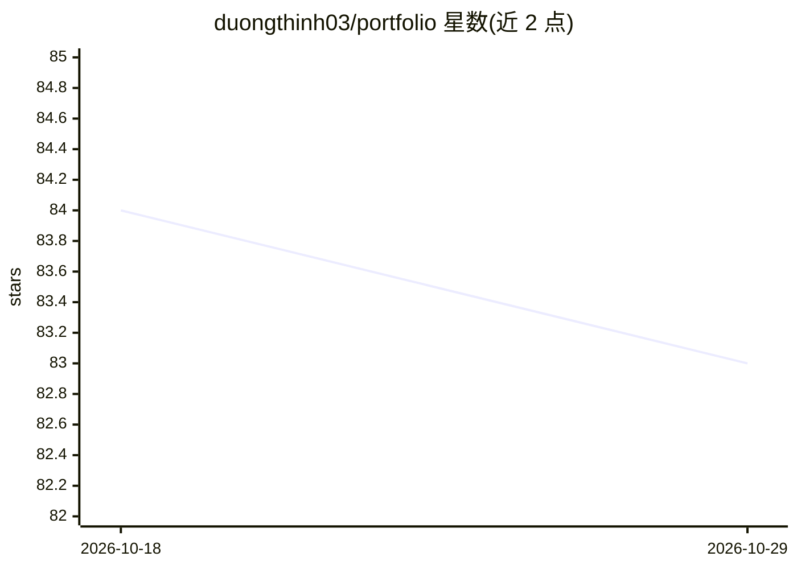

# duongthinh03/portfolio

⭐ 83 · Python · 推送 2026-06-30 · [GitHub](https://github.com/duongthinh03/portfolio) · [官网](https://dqt-03.vercel.app/) · 个人维护

**个人作品集网站：展示全栈/.NET 开发者的项目与经历**

使用 Vite + Vue 3 + TypeScript 从零构建（无模板）的个人 portfolio 网页，面向求职/个人展示。功能包括明暗主题（localStorage 持久化）、VI/EN 双语（composable 实现 i18n）、滚动动画与 3D 倾斜效果、SEO 元数据（Open Graph/Twitter Card/schema.org）、打印样式导出 CV/PDF、无障碍支持（prefers-reduced-motion、ARIA）。开发流程为 npm 安装依赖并运行 dev/build 脚本，部署到 Vercel。README 中未描述任何 AI 功能实现。

## 筛选速览

| 维度 | 判定 | 备注 |
|---|---|---|
| AI 角色 | `ai-enhanced` | 去掉 AI 部分产品仍成立 |
| 许可风险 | `none` | — |
| 部署形态 | `library` | 以包/库形式分发 |
| 模型依赖 | — | README 未给出锁定关系 |
| 硬件要求 | — | 无带数字的原话,不猜 |
| 安装摩擦 | `low` | 无编译、无系统依赖或容器化 |
| 成熟度 | — | 结构信号不足 |

## 能力要点

- Vite + Vue 3 + TypeScript 构建，无模板
- VI/EN 双语与明暗主题切换
- SEO 元数据与 schema.org 结构化数据
- 打印样式支持 CV 导出 PDF

## 适用场景

- 展示个人项目、技能与工作经历
- 作为求职用的在线简历并导出 PDF

## 场景标签

 · 领域:个人作品集/Web 前端

## 证据(README 行号)

> L3: Trang portfolio cá nhân (Fullstack / .NET Developer). Xây bằng **Vite + Vue 3 + TypeScript**, không dùng template.
> L5: ## Tính năng

## 星数曲线

2026-10-18 84 → 2026-10-29 83（-1）

---
*卡片 v1 · prompt 1.4 · 生成 2026-10-24 · 置信度 low · 依据 README sha `82c27c6b3a06` · [字段定义](../../DATASET.md)*
