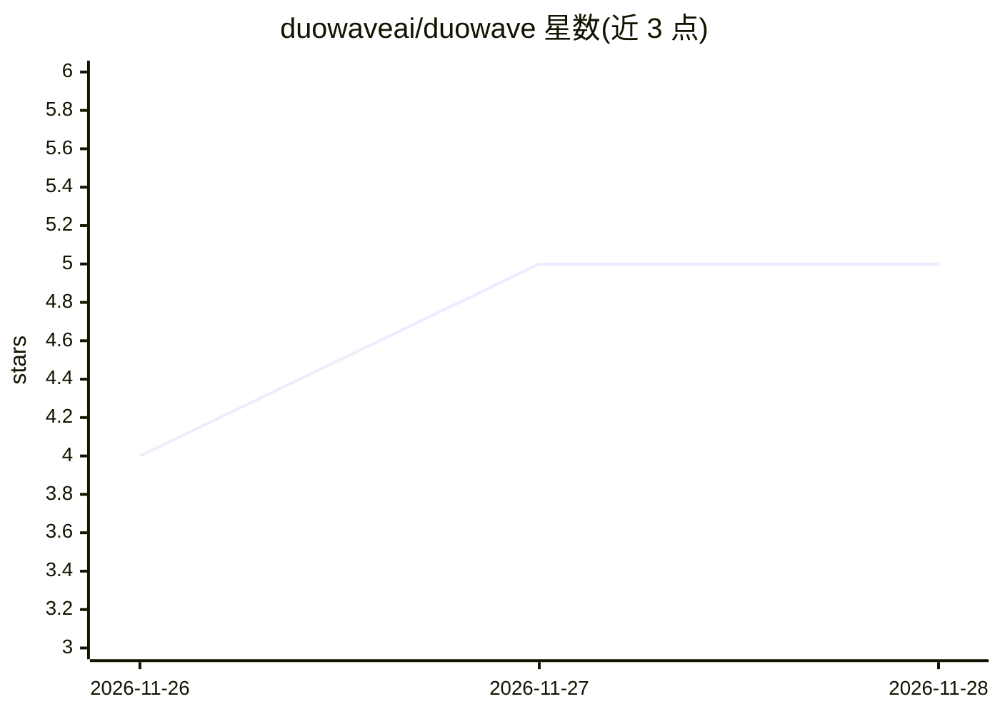

# duowaveai/duowave

⭐ 5 · Rust · Apache-2.0 · 推送 2026-11-27 · [GitHub](https://github.com/duowaveai/duowave) · [官网](https://duowave.ai) · 组织维护

**为 root 过的 Yandex 音箱与电脑提供开源语音 AI 助手**

面向已 root 的 Yandex 音箱与电脑的开源语音助手：可接入自有 API key、OpenRouter 订阅或本地模型（Ollama/LM Studio）回答提问，支持录制自定义语音与角色设定；用户可通过语音让 agent 生成小应用与桌面组件，并提供 MagicPlace 应用商店一键安装。部署方式包括一键脚本、桌面安装包、Docker 与源码构建。限制：需自行获取音箱 root 与 SSH，DuoWave 本身不做 root，仅在 Station Lite 2 上完成验证。

## 筛选速览

| 维度 | 判定 | 备注 |
|---|---|---|
| AI 角色 | `ai-native` | 本体是模型或模型工具 |
| 许可风险 | `permissive` | Apache-2.0 |
| 部署形态 | `self-host` | docker 或自建部署 |
| 模型依赖 | local-ok | 支持本地模型 |
| 硬件要求 | — | 无带数字的原话,不猜 |
| 安装摩擦 | `low` | 无编译、无系统依赖或容器化 |
| 成熟度 | — | 结构信号不足 |

## 能力要点

- 任意模型接入：Claude/ChatGPT/Gemini/DeepSeek/YandexGPT、OpenRouter 或本地 Ollama/LM Studio
- 语音生成应用与组件：agent 自动写文件并校验后上屏
- 原 Alice 功能保留，可按钮切换应答方（Alice/Alice+AI/仅 AI）
- 本地优先：云端模型仅接收问题文本，可完全本地运行

## 适用场景

- 把 root 过的 Yandex 音箱改成接入自选大模型的语音助手
- 录一段自己的声音替换默认语音并创建专属角色
- 语音下指令让助手生成桌面小组件和小应用
- 在家庭服务器/NAS 上用 Docker 自托管助手服务

## 场景标签

`语音 Agent` `AI 助手` · 领域:对话与助手

## 证据(README 行号)

> L11:  An open-source voice assistant for a rooted Yandex Station and your computer: any AI model, your own voice, apps
> L25: - **Любая модель.** Claude, ChatGPT, Gemini, DeepSeek, YandexGPT и другие: по своему ключу, через OpenRouter или по
> L31: - **Приложения голосом.** Скажите «Алиса, сделай виджет с курсом биткоина», и он появится на столе. Готовые

## 星数曲线

2026-11-26 4 → 2026-11-28 5（+1）

---
*卡片 v1 · prompt 1.4 · 生成 2026-11-26 · 置信度 mid · 依据 README sha `ab5f53b22449` · [字段定义](../../DATASET.md)*
