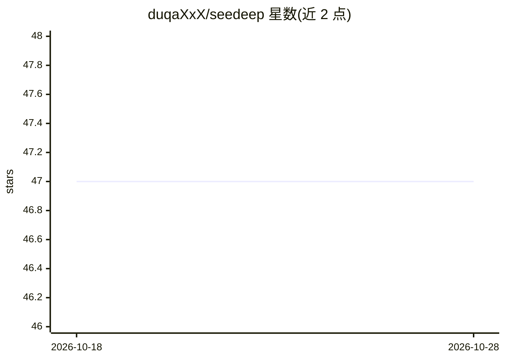

# duqaXxX/seedeep

⭐ 48 · TypeScript · MIT · 推送 2026-10-23 · [GitHub](https://github.com/duqaXxX/seedeep) · [官网](https://www.npmjs.com/package/seedeep) · 个人维护

**Claude Code 会话的本地只读实时观测工具**

读取 Claude Code 写入磁盘的会话日志，实时重建每一轮对话：上下文窗口填充、每次 API 调用的延迟与 token 拆分、每个工具调用及结果、子代理及其模型归属；事后可回看，并提供 Trace、菜单栏 tray、Home 统计、跨会话搜索等界面。只读、无代理、无守护进程，会话内容默认不离开本机。通过 npm 安装（Node/Bun），或下载携带自带运行时的独立二进制（macOS/Linux/Windows）。Windows/Linux 使用记录有限，处于活跃开发中。

## 筛选速览

| 维度 | 判定 | 备注 |
|---|---|---|
| AI 角色 | `ai-ecosystem` | LLM/agent 周边工具 |
| 许可风险 | `permissive` | MIT |
| 部署形态 | `desktop` | 安装包/桌面程序 |
| 模型依赖 | — | README 未给出锁定关系 |
| 硬件要求 | — | 无带数字的原话,不猜 |
| 安装摩擦 | `low` | 无编译、无系统依赖或容器化 |
| 成熟度 | `idea` | |

## 能力要点

- tail 会话日志实时重建上下文窗口、API 调用与子代理树
- 只读设计：不修改、不代理、不拦截会话，内容不出本机
- 七项确定性检查（无 LLM）按轮次评分并引用官方文档依据
- 独立二进制携带自带 Bun 运行时与浏览器 GUI，仅留 ~/.seedeep/

## 适用场景

- 实时查看 Claude Code 上下文窗口与子代理的 token 消耗
- 发现静默失败的 API 调用与卡在权限确认的会话
- 事后统计各会话产出、浪费来源与按模型划分的花费

## 场景标签

`LLM 可观测性` · 领域:评测与运维

## 证据(README 行号)

> L9: Claude Code writes a session log to disk as it runs. `seedeep` tails that log and
> L30: - A failed API call ends the turn silently. An expired login, a session limit, an
> L38: - Subagent spend is invisible from the terminal. The live tree shows each subagent as

## 星数曲线

2026-10-18 47 → 2026-10-28 47（+0）

---
*卡片 v1 · prompt 1.4 · 生成 2026-10-25 · 置信度 high · 依据 README sha `8a363f08eaa0` · [字段定义](../../DATASET.md)*
