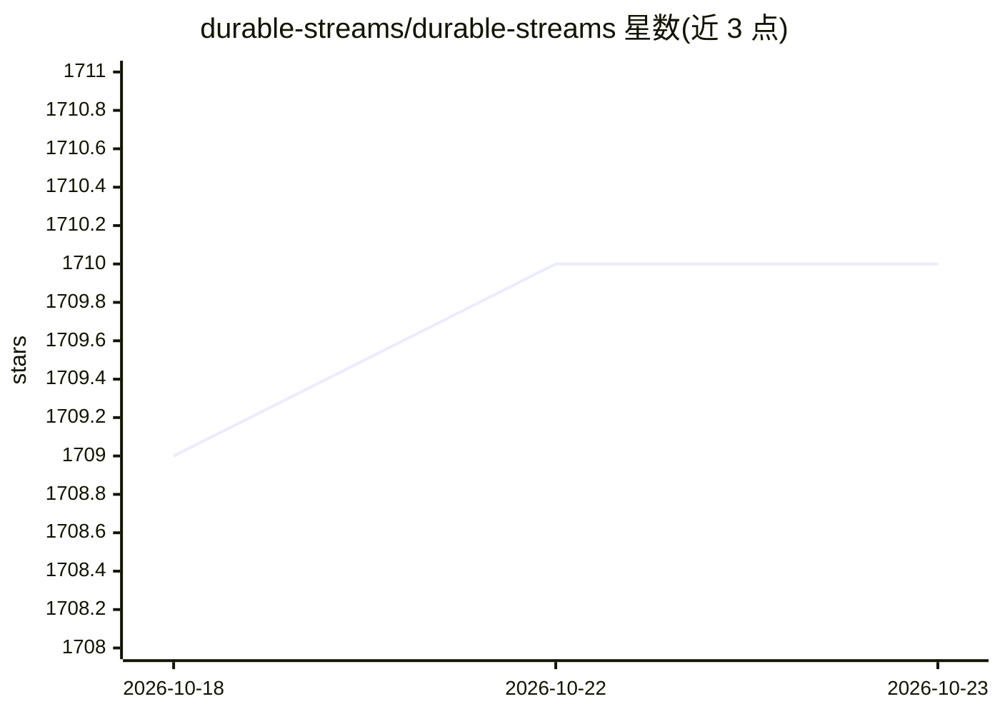

# durable-streams/durable-streams

⭐ 1,710 · TypeScript · MIT · 推送 2026-09-28 · [GitHub](https://github.com/durable-streams/durable-streams) · [官网](https://durablestreams.com) · 组织维护

**面向 agent 会话的持久化、可重放实时流数据原语**

提供基于 HTTP 的有序、可重放字节流协议，用于构建可恢复的 agent 会话与多用户、多 agent 协作系统：支持 offset 断点续读、SSE/long-poll 实时尾随、exactly-once 投递与 CDN 友好的大规模扇出。场景覆盖 LLM token 流式输出重连恢复、agentic 应用的工具输出与进度事件流、数据库同步、协同编辑与事件溯源。客户端覆盖 TypeScript/Python/Go/Java/Rust 等十余种语言，服务器提供 Node.js 参考实现与 Caddy 生产插件。项目状态标注为 Beta，协议基于 Electric 一年半生产使用。

## 筛选速览

| 维度 | 判定 | 备注 |
|---|---|---|
| AI 角色 | `ai-ecosystem` | LLM/agent 周边工具 |
| 许可风险 | `permissive` | MIT |
| 部署形态 | `library` | 以包/库形式分发 |
| 模型依赖 | — | README 未给出锁定关系 |
| 硬件要求 | — | 无带数字的原话,不猜 |
| 安装摩擦 | `medium` | 含编译或系统依赖之一 |
| 成熟度 | `idea` | |

## 能力要点

- 基于标准 HTTP 的 offset 断点续读与 exactly-once 投递协议
- 十余种语言客户端库与 Node.js/Caddy 服务器实现
- 支持流即 URL 的多端共享观看与多标签页同步
- 提供 Durable Proxy（AI token 流代理）、StreamDB、StreamFS 等上层抽象

## 适用场景

- 聊天/副驾驶应用在刷新或断网后从中断点恢复 LLM token 流
- agentic 应用流式输出工具调用与进度事件并保留完整历史
- 多设备、多观众实时观看同一条数据流

## 场景标签

`Agent 记忆` · 领域:Agent 开发

## 证据(README 行号)

> L19: Durable Streams are the data primitive for the agent loop.
> L21: Persistent, addressable, real‑time streams for building resilient agent sessions and collaborative multi-user, mult
> L38: - **AI conversation streaming** - Stream LLM token responses with resume capability across reconnections

## 星数曲线

2026-10-18 1,709 → 2026-10-23 1,710（+1）

---
*卡片 v1 · prompt 1.4 · 生成 2026-10-21 · 置信度 high · 依据 README sha `1eafa1386e0c` · [字段定义](../../DATASET.md)*
