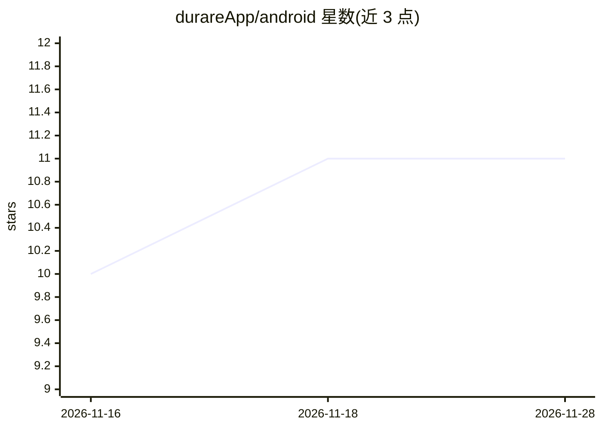

# durareApp/android

⭐ 11 · Kotlin · GPL-3.0 · 推送 2026-03-06 · [GitHub](https://github.com/durareApp/android) · [官网](https://play.google.com/store/apps/details?id=com.subhajitrajak.durare) · 个人维护

**用前置摄像头人脸位置实时计数俯卧撑的 Android 应用**

基于 ML Kit 人脸检测的 Android 应用：通过前置摄像头读取人脸在画面中的占比，按 50%/25% 的上下位阈值与连续帧确认逻辑判定一次俯卧撑，并实时显示计数。功能含人脸叠加可视反馈、灵敏度参数可在 settings/personalize 中调整。构建需 Android Studio、Gradle 同步及接入 Firebase（Authentication、Firestore），通过 Google Play 或 GitHub Releases 分发。

## 筛选速览

| 维度 | 判定 | 备注 |
|---|---|---|
| AI 角色 | `ai-native` | 本体是模型或模型工具 |
| 许可风险 | `viral` | GPL-3.0 |
| 部署形态 | `None` |  |
| 模型依赖 | — | README 未给出锁定关系 |
| 硬件要求 | — | 无带数字的原话,不猜 |
| 安装摩擦 | `low` | 无编译、无系统依赖或容器化 |
| 成熟度 | — | 结构信号不足 |

## 能力要点

- ML Kit 实时人脸检测驱动的自动俯卧撑计数
- 基于人脸占屏比例（50%/25% 阈值）与 3 帧连续确认的判定逻辑
- 人脸叠加与位置指示的可视反馈、实时计数显示
- 上下阈值可在设置中自定义

## 适用场景

- 居家无器械时用手机摄像头自动记录俯卧撑个数
- 锻炼中实时查看计数与动作位置反馈
- 按个人情况调整检测灵敏度

## 场景标签

 · 领域:移动应用/健康健身

## 证据(README 行号)

> L6:  An Android application that uses face detection to count push-ups in real-time. The app detects your face position 
> L38: - **Real-time face detection** using ML Kit

## 星数曲线

2026-11-16 10 → 2026-11-28 11（+1）

---
*卡片 v1 · prompt 1.4 · 生成 2026-11-18 · 置信度 high · 依据 README sha `b8e9b3e391b2` · [字段定义](../../DATASET.md)*
