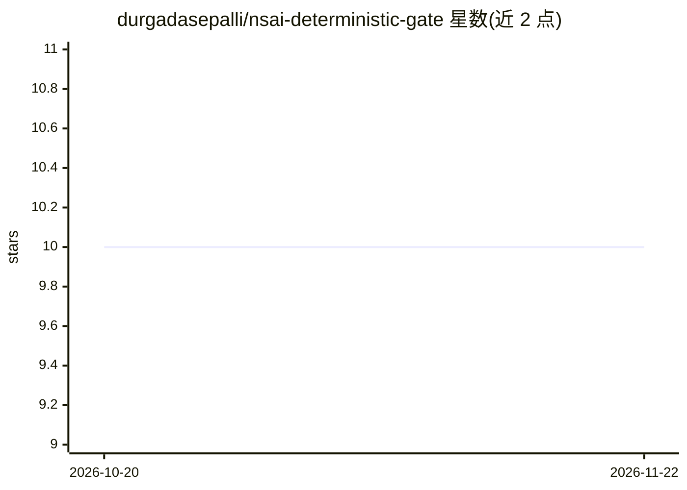

# durgadasepalli/nsai-deterministic-gate

⭐ 10 · Java · Apache-2.0 · 推送 2026-11-15 · [GitHub](https://github.com/durgadasepalli/nsai-deterministic-gate) · 个人维护

**Spring Boot 库：LLM 回答在展示前按 YAML 业务规则做确定性校验**

以 Spring Boot Starter 形式提供的确定性护栏库：用 @NSDeterministicGate 注解调用模型的方法，Spring AOP 切面把模型草拟的回答交给规则连接器逐条校验，返回每条违规并写审计日志。规则可存于 YAML 或 Neo4j（支持意图间继承）。设计上 fail-closed：连接器未注册、意图无规则或规则文件有拼写错误时一律拒绝。支持 HARD_REJECT 与 SOFT_REPAIR（仅 clamp 修复，不涉及模型）两种执行模式，可配 Ollama 本地模型或 Mock LLM 本地运行。

## 筛选速览

| 维度 | 判定 | 备注 |
|---|---|---|
| AI 角色 | `ai-ecosystem` | LLM/agent 周边工具 |
| 许可风险 | `permissive` | Apache-2.0 |
| 部署形态 | `self-host` | docker 或自建部署 |
| 模型依赖 | local-ok | 支持本地模型 |
| 硬件要求 | — | 无带数字的原话,不猜 |
| 安装摩擦 | `low` | 无编译、无系统依赖或容器化 |
| 成熟度 | — | 结构信号不足 |

## 能力要点

- @NSDeterministicGate 注解 + Spring AOP 拦截，规则校验返回精确违规项
- fail-closed 设计：无规则意图默认拒绝，规则拼写错误启动即报错
- YAML 与 Neo4j 图两种规则源，图模式支持意图规则继承与 Caffeine 缓存
- SOFT_REPAIR 模式仅做确定性 clamp 修复，修复不调用模型

## 适用场景

- 放贷、保险等场景在用户看到前拦截不合规的 LLM 回答
- 将 AI 回答的最终是否决策交给可测试的显式规则
- 用 Neo4j 图统一维护带继承关系的企业政策规则
- 本地 Docker 环境无云账号即可试运行护栏流程

## 场景标签

 · 领域:LLM 基础设施/输出治理

## 证据(README 行号)

> L7: **Deterministic guardrails for LLM output in Spring Boot.** Check AI answers against YAML business rules before user
> L52: 1. You annotate the method that calls the model with `@NSDeterministicGate`.
> L62: The library is the `nsai-gate-spring-boot-starter` module; `nsai-gate-demo` is the demo application above. Adding t

## 星数曲线

2026-10-20 10 → 2026-11-22 10（+0）

---
*卡片 v1 · prompt 1.4 · 生成 2026-11-19 · 置信度 high · 依据 README sha `26dfb617834d` · [字段定义](../../DATASET.md)*
