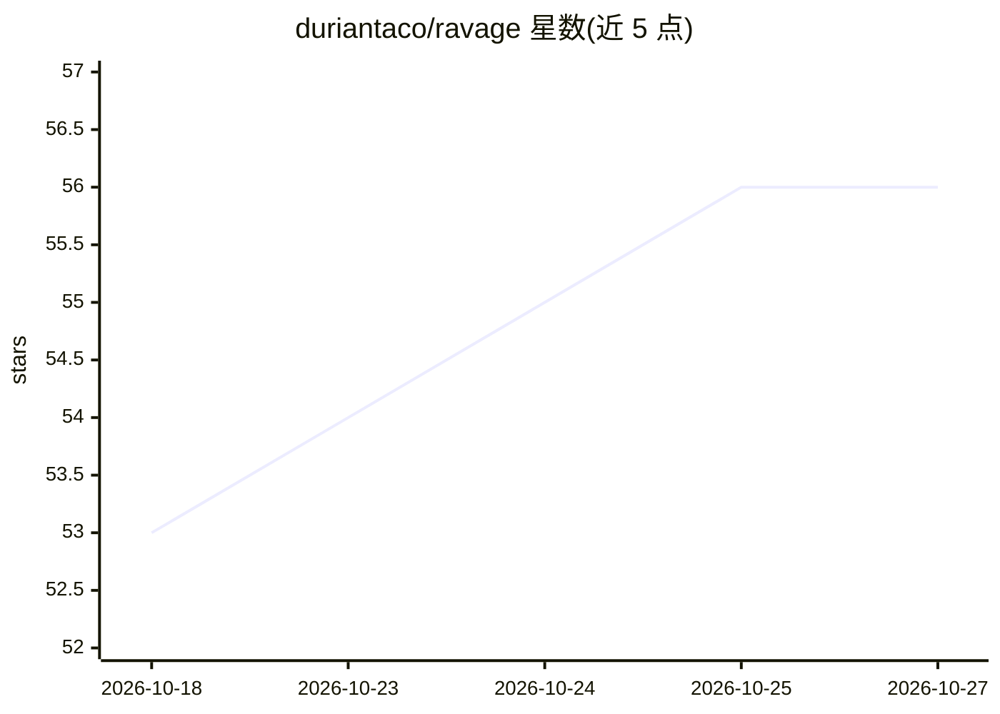

# duriantaco/ravage

⭐ 56 · Python · Apache-2.0 · 推送 2026-10-26 · [GitHub](https://github.com/duriantaco/ravage) · 个人维护

**面向授权目标的 AI 驱动 Web 安全测试 CLI**

证据优先的命令行工具，用于评估用户自有或获书面授权的 Web 应用：确定性侦察扫描（无需模型）与可选的模型驱动攻击循环相结合，将范围、认证、流量记账与证据保持在代码可控边界内。支持源码引导验证（本地 Flask/FastAPI 映射）、只读仓库审查、托管认证与授权矩阵。进程级攻击默认走 Docker，也可显式选择主机执行；需 Python 3.12、Git、macOS/Linux/WSL，模型命令需提供商 API key。自述为 pre-1.0 研究 alpha，不修复发现的问题。

## 筛选速览

| 维度 | 判定 | 备注 |
|---|---|---|
| AI 角色 | `ai-ecosystem` | LLM/agent 周边工具 |
| 许可风险 | `permissive` | Apache-2.0 |
| 部署形态 | `None` |  |
| 模型依赖 | — | README 未给出锁定关系 |
| 硬件要求 | — | 无带数字的原话,不猜 |
| 安装摩擦 | `low` | 无编译、无系统依赖或容器化 |
| 成熟度 | `idea` | |

## 能力要点

- 无模型确定性侦察扫描与证据门控的模型驱动攻击循环
- 源码引导验证：本地 Flask/FastAPI 路由到汇聚点映射，仍需运行时差分证据
- 只读仓库审查 agent 与托管认证（会话、角色感知地图、授权矩阵）
- 区分观察、候选发现与确认漏洞，输出 report.json/report.md 与证据引用

## 适用场景

- 对自己拥有或获授权的开发/测试环境做 Web 应用安全评估
- 在本地一次性环境中跑模型驱动的渗透测试演示（XBEN/TestFire）
- 对 Flask/FastAPI 应用做源码引导的 SQL 注入假设验证
- 多身份场景下映射只读路由可见性差异并生成授权矩阵

## 场景标签

`网络安全` · 领域:学习与行业

## 证据(README 行号)

> L5: Ravage is an evidence-first CLI for assessing a running web application that
> L7: reconnaissance and validation with an optional model-driven attack loop, while
> L82: Add a supported provider key, such as <code>OPENAI_API_KEY</code>, to

## 星数曲线

2026-10-18 53 → 2026-10-27 56（+3）

---
*卡片 v1 · prompt 1.4 · 生成 2026-10-24 · 置信度 high · 依据 README sha `bb774193b977` · [字段定义](../../DATASET.md)*
