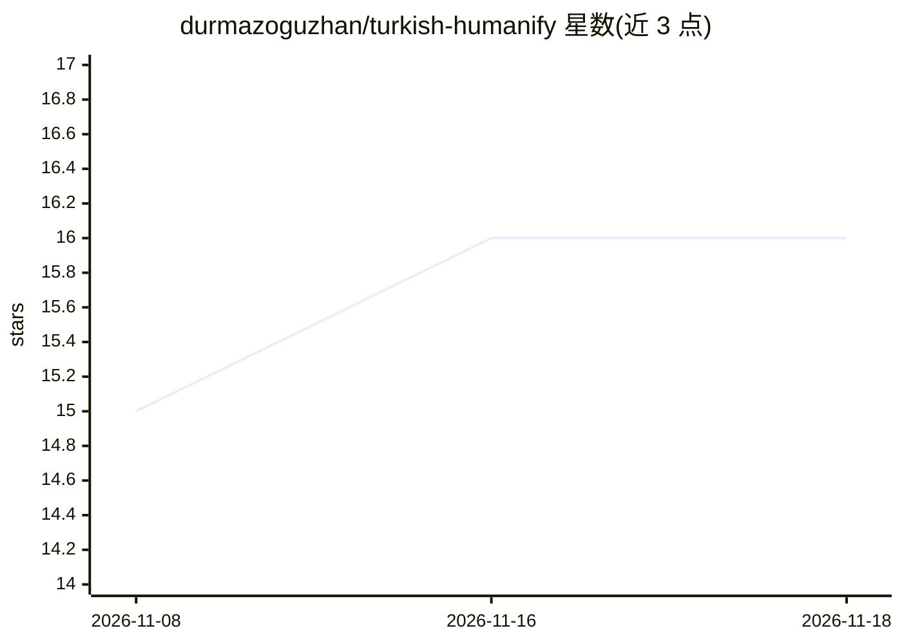

# durmazoguzhan/turkish-humanify

⭐ 16 · Shell · MIT · 推送 2026-09-04 · [GitHub](https://github.com/durmazoguzhan/turkish-humanify) · 个人维护

**面向 Claude 用户的土耳其语 AI 味文本人性化改写技能**

作为 Claude 技能与 Claude Code 插件分发，将 AI 生成的土耳其语改写为更接近人工写作的文本。机制包括：SKILL.md 作为路由，七个参考文件按需读取；14 条句法层规则（分支方向、ulaç 连动词、-DIr 删减等）、语域层（四种语域控制规则施加力度）、表层规则（术语保留与按发音变格）。提供 repair/write 两种模式，输出仅为改写后文本。仅适用于土耳其语文本处理。

## 筛选速览

| 维度 | 判定 | 备注 |
|---|---|---|
| AI 角色 | `ai-ecosystem` | LLM/agent 周边工具 |
| 许可风险 | `permissive` | MIT |
| 部署形态 | `library` | 以包/库形式分发 |
| 模型依赖 | locked-api |  |
| 硬件要求 | — | 无带数字的原话,不猜 |
| 安装摩擦 | `low` | 无编译、无系统依赖或容器化 |
| 成熟度 | — | 结构信号不足 |

## 能力要点

- 14 条句法规则重构土耳其语句子架构（分支方向、连动词、-mIş 证据标记等）
- 四种语域（blog/技术/企业/学术）决定各层规则施加力度
- 技术术语按发音而非拼写变格（cache'i、SQL'i）
- 每个改写手段在输出前经过删除测试以避免机械痕迹

## 适用场景

- 把 AI 生成的土耳其语博客文章改写成更自然的读感
- 技术文档保持术语原样的同时改善土耳其语表达
- 为企业或学术场景的土耳其语文本按语域调整改写力度

## 场景标签

`AI 写作` · 领域:内容生成

## 证据(README 行号)

> L18: **turkish-humanify** is a Claude skill and Claude Code plugin that turns
> L76: `skills/turkish-humanify/SKILL.md` is a thin router. Everything else lives in

## 星数曲线

2026-11-08 15 → 2026-11-18 16（+1）

---
*卡片 v1 · prompt 1.4 · 生成 2026-11-18 · 置信度 high · 依据 README sha `77ca6249a4a4` · [字段定义](../../DATASET.md)*
