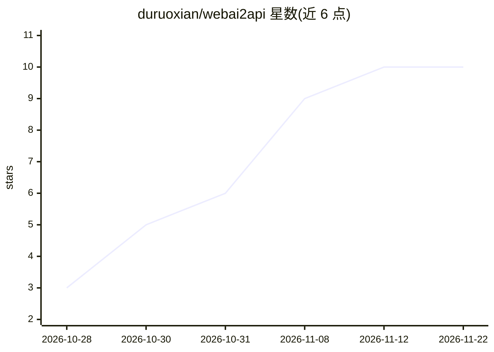

# duruoxian/webai2api

⭐ 10 · Python · MIT · 推送 2026-11-04 · [GitHub](https://github.com/duruoxian/webai2api) · [官网](https://github.com/duruoxian/webai2api/releases/latest) · 个人维护 · 中文 README

**把四家 AI 网页版反代成 OpenAI 兼容 API 的本地网关**

本地运行的 API 网关：通过反向代理 DeepSeek、智谱清言、Kimi、通义千问的网页版，对外提供 OpenAI 兼容接口（/v1）与 Anthropic 兼容接口（/v1/messages），共十个模型，四平台均支持工具调用。内置中文管理面板管理账号与 API Key，多账号轮询并按错误类型分诊换号（auth/rate/banned/content），带会话粘性与空响应兜底。Windows 提供免 Python 的 exe，其他平台可源码运行。README 声明仅供个人学习与本地自用。

## 筛选速览

| 维度 | 判定 | 备注 |
|---|---|---|
| AI 角色 | `ai-ecosystem` | LLM/agent 周边工具 |
| 许可风险 | `permissive` | MIT |
| 部署形态 | `desktop` | 安装包/桌面程序 |
| 模型依赖 | — | README 未给出锁定关系 |
| 硬件要求 | — | 无带数字的原话,不猜 |
| 安装摩擦 | `low` | 无编译、无系统依赖或容器化 |
| 成熟度 | — | 结构信号不足 |

## 能力要点

- 将 DeepSeek/智谱/Kimi/千问网页版统一为 OpenAI 兼容 API，支持工具调用与流式
- 提供 Anthropic 兼容端点 /v1/messages，Claude Code / ZCode 原生接入
- 多账号轮询调度与按错误类型分诊的自动换号容错
- 内置中文管理面板，管理账号、API Key 与 token 用量统计

## 适用场景

- 让 opencode、Cherry Studio 等 OpenAI 兼容客户端使用网页版模型
- 接入 Claude Code 等编码代理进行文件读写与命令执行
- 个人本地自用，通过面板管理多账号与多 API Key

## 场景标签

`模型网关` · 领域:Agent 开发

## 证据(README 行号)

> L5: 把 DeepSeek、智谱清言、Kimi、通义千问四家 AI 的**网页版**反向代理成统一的
> L6: OpenAI 兼容 API，自带中文管理面板。Windows 下解压即用，全程本机运行。
> L33: - **Anthropic 兼容**：`POST /v1/messages`（含工具调用与流式），Claude Code / ZCode 原生接入

## 星数曲线

2026-10-28 3 → 2026-11-22 10（+7）

---
*卡片 v1 · prompt 1.4 · 生成 2026-11-19 · 置信度 high · 依据 README sha `3f1aaa443517` · [字段定义](../../DATASET.md)*
