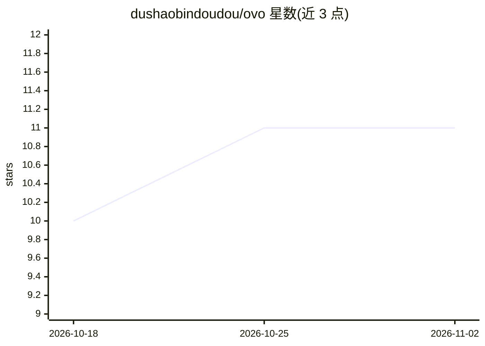

# dushaobindoudou/ovo

⭐ 11 · TypeScript · MIT · 推送 2026-08-17 · [GitHub](https://github.com/dushaobindoudou/ovo) · [官网](https://github.com/dushaobindoudou/ovo#readme) · 个人维护 · 中文 README

**macOS 主动式 AI 桌面助手：观察屏幕并主动建议与执行操作**

面向 macOS 用户的 Electron 桌面 AI 助手：每隔几秒通过 OCR 与窗口上下文观察屏幕，经多轮推理流水线和长期知识图谱理解用户意图，主动给出下一步建议（起草回复、复制片段、提醒截止时间）并可执行或定时执行操作。支持玻璃盒透明推理链展示、按动作类型的教学式反馈、敏感数据脱敏、应用黑名单与暂停。截图与 OCR 在本地完成，LLM 后端可自选 Claude Code / OpenClaw / Hermes / 直接 API，API key 用 macOS Keychain 加密存储。提供 macOS 安装包下载与源码构建，Windows/Linux 支持在计划中。

## 筛选速览

| 维度 | 判定 | 备注 |
|---|---|---|
| AI 角色 | `ai-native` | 本体是模型或模型工具 |
| 许可风险 | `permissive` | MIT |
| 部署形态 | `library` | 以包/库形式分发 |
| 模型依赖 | locked-api |  |
| 硬件要求 | — | 无带数字的原话,不猜 |
| 安装摩擦 | `low` | 无编译、无系统依赖或容器化 |
| 成熟度 | `idea` | |

## 能力要点

- OCR + 窗口上下文的屏幕观察与多轮推理建议流水线
- 基于实体/关系/记忆事件的个人知识图谱长期记忆
- 透明推理链（所见/所想/所决/所为均记录可查）与教学式反馈
- 本地优先隐私设计：敏感数据脱敏、应用黑名单、Keychain 加密 API key

## 适用场景

- 写邮件或文档时自动获得下一步建议与草稿
- 把重复操作交给助手定时或按日程执行
- 查看 AI 每一步看到和想到了什么，进行审计与纠偏

## 场景标签

`AI 助手` `Agent 记忆` `GUI 自动化` · 领域:Agent 开发

## 证据(README 行号)

> L31: **Ovo is a proactive AI desktop assistant that watches what you're doing — and helps before you have to ask.**
> L35: - It **observes your screen** every few seconds (OCR + window context).

## 星数曲线

2026-10-18 10 → 2026-11-02 11（+1）

---
*卡片 v1 · prompt 1.4 · 生成 2026-11-02 · 置信度 mid · 依据 README sha `0ee411d84d95` · [字段定义](../../DATASET.md)*
