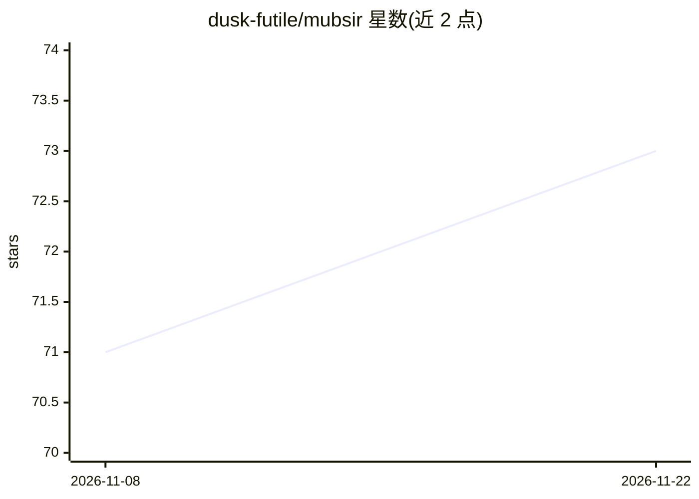

# dusk-futile/mubsir

⭐ 73 · C# · NOASSERTION · 推送 2026-11-15 · [GitHub](https://github.com/dusk-futile/mubsir) · 个人维护

**面向盲人与低视力者的 Windows 语音代理：按住一键用阿/英文操控整台电脑**

运行于 Windows 10/11 的免费开源语音代理，为盲人和低视力用户设计，与 NVDA 屏幕阅读器并行工作。用户按住右 Ctrl 说话（阿拉伯语、英语或混合），它读取屏幕内容、朗读网页/Word/PDF/扫描阿语书籍、操作应用、填表、播放 YouTube、管理文件并发音回答。大脑服务可选 Gemini、Claude Haiku 或任何 OpenAI 格式服务，自带密钥；银行页面关闭 AI，敏感操作需人工确认。安装经 Releases zip 与 PowerShell 脚本完成。

## 筛选速览

| 维度 | 判定 | 备注 |
|---|---|---|
| AI 角色 | `ai-native` | 本体是模型或模型工具 |
| 许可风险 | `permissive` | NOASSERTION |
| 部署形态 | `desktop` | 安装包/桌面程序 |
| 模型依赖 | locked-api |  |
| 硬件要求 | — | 无带数字的原话,不猜 |
| 安装摩擦 | `medium` | 含编译或系统依赖之一 |
| 成熟度 | — | 结构信号不足 |

## 能力要点

- 阿英混合单句语音指令操控整台 PC，与 NVDA 屏幕阅读器协同
- 朗读网页/Word/PDF/扫描阿语书籍并从上次位置继续
- 大脑/听力/语音可选多个服务，自带密钥，Gemini 免费额度可用
- 银行页面自动关闭 AI，发送/支付/删除需用户确认

## 适用场景

- 盲人或低视力者用语音操作 Windows 应用和阅读文档
- 阿拉伯语为主的用户用阿英混合句子与电脑交互
- 低配 4 GB 内存的旧电脑上语音操控整台 PC

## 场景标签

`语音 Agent` `GUI 自动化` `文档问答` · 领域:效率与自动化

## 证据(README 行号)

> L15: Most AI assistants live in a chat box and tell you what to click. **Mubsir does the clicking.** It reads your scree
> L30: |**Works the whole PC**|Opens apps, sites and files, reads you numbered results, clicks what it can see, fills in f
> L56: |Brain|Google Gemini, Claude Haiku, or any service by its address|Gemini is free within Google's limits (Google may

## 星数曲线

2026-11-08 71 → 2026-11-22 73（+2）

---
*卡片 v1 · prompt 1.4 · 生成 2026-11-18 · 置信度 high · 依据 README sha `232703a072eb` · [字段定义](../../DATASET.md)*
