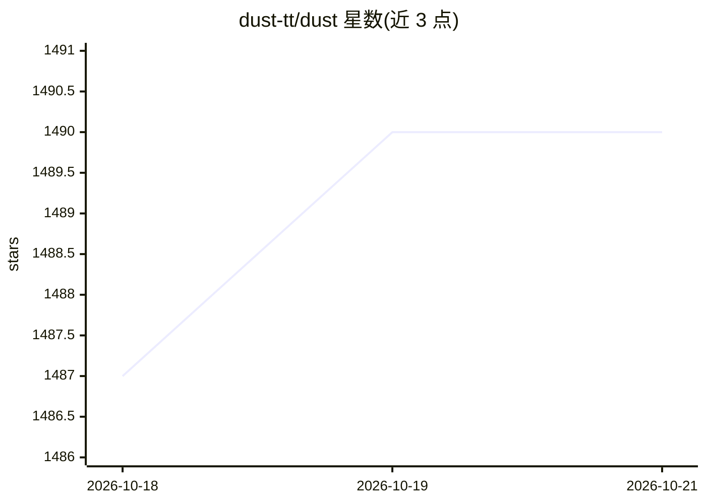

# dust-tt/dust

⭐ 1,492 · TypeScript · MIT · 推送 2026-10-22 · [GitHub](https://github.com/dust-tt/dust) · [官网](https://dust.tt) · 组织维护

**构建自定义 AI agent 的工作平台**

Dust 是一个自定义 AI agent 平台，面向需要为工作流程搭建 AI agent 的用户与开发者。README 仅提供一句话定位并链接到用户指南与开发者平台文档，说明其以托管/文档化方式交付。仓库主题标签包含 agents、LLM 与 Rust。README 未展开具体功能机制、安装步骤或使用限制，详情需查阅其文档站点。

## 筛选速览

| 维度 | 判定 | 备注 |
|---|---|---|
| AI 角色 | `ai-ecosystem` | LLM/agent 周边工具 |
| 许可风险 | `permissive` | MIT |
| 部署形态 | `None` |  |
| 模型依赖 | — | README 未给出锁定关系 |
| 硬件要求 | — | 无带数字的原话,不猜 |
| 安装摩擦 | `low` | 无编译、无系统依赖或容器化 |
| 成熟度 | — | 结构信号不足 |

## 能力要点

- 自定义 AI agent 构建平台
- 提供用户指南与开发者平台文档

## 适用场景

- 为团队工作流搭建定制 AI agent
- 通过开发者平台扩展 agent 能力

## 场景标签

`Agent 框架` · 领域:Agent 开发

## 证据(README 行号)

> L3: Custom AI agent platform to speed up your work.
> L5: Check out our user guides and developer platform

## 星数曲线

2026-10-18 1,487 → 2026-10-21 1,490（+3）

---
*卡片 v1 · prompt 1.4 · 生成 2026-10-21 · 置信度 low · 依据 README sha `1927d19dfedb` · [字段定义](../../DATASET.md)*
