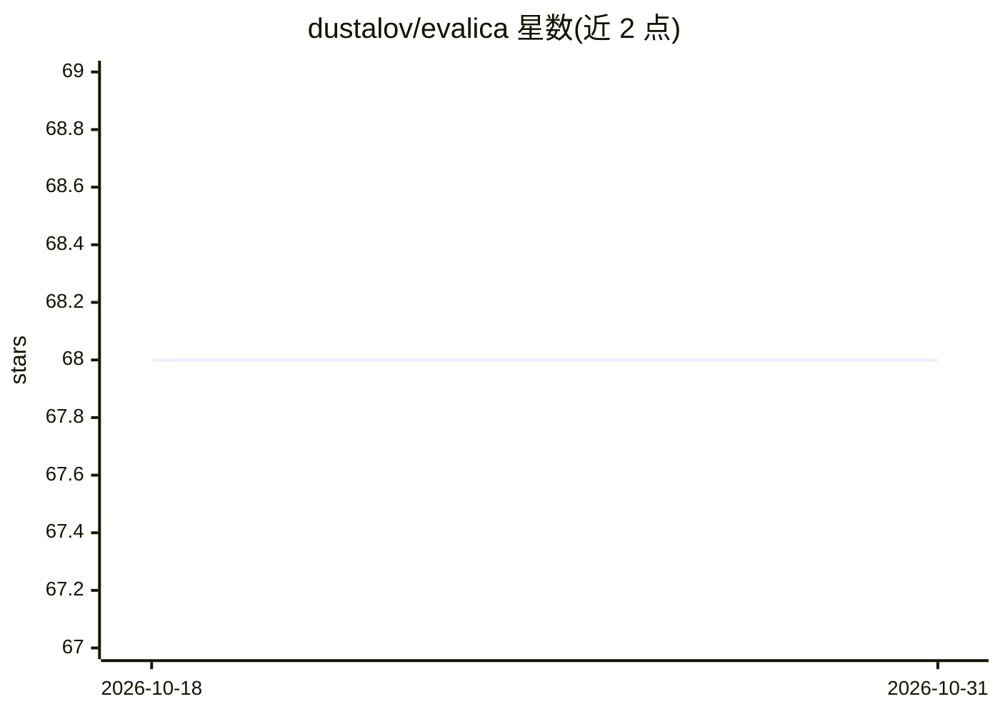

# dustalov/evalica

⭐ 68 · Python · Apache-2.0 · 推送 2026-10-29 · [GitHub](https://github.com/dustalov/evalica) · [官网](https://evalica.readthedocs.io/latest/) · 个人维护

**成对比较评测工具包：Elo/Bradley-Terry 排名与可靠性计算**

用于统计分析的评测工具包，核心是基于 Rust 实现并暴露 Python API 的成对比较方法：Counting、Average Win Rate、Bradley-Terry、Elo、Eigenvalue、PageRank、Newman，以及 Krippendorff's alpha 评分者间可靠性度量，支持 bootstrap 置信区间与多种距离度量。输入为三列（Item X/Item Y/Winner）或评分矩阵，兼容 NumPy 数组与 pandas 数据框。另提供 CLI 与内置 Gradio Web 应用。面向需要构建排行榜或评测分析的开发者与科研用户。

## 筛选速览

| 维度 | 判定 | 备注 |
|---|---|---|
| AI 角色 | `ai-ecosystem` | LLM/agent 周边工具 |
| 许可风险 | `permissive` | Apache-2.0 |
| 部署形态 | `library` | 以包/库形式分发 |
| 模型依赖 | — | README 未给出锁定关系 |
| 硬件要求 | — | 无带数字的原话,不猜 |
| 安装摩擦 | `low` | 无编译、无系统依赖或容器化 |
| 成熟度 | — | 结构信号不足 |

## 能力要点

- 8 种成对比较与可靠性方法，Python 与 Rust 双实现
- Krippendorff's alpha 支持 nominal/ordinal/interval/ratio 及自定义距离
- 提供 CLI 与内置 Gradio Web 应用
- 兼容 NumPy 数组与 pandas 数据框

## 适用场景

- 为 LLM 或其他系统构建成对比较排行榜
- 计算评分者间一致性（Krippendorff's alpha）
- 在 shell 脚本或 notebook 中做排名原型分析

## 场景标签

`模型评测` · 领域:评测与运维

## 证据(README 行号)

> L13: **Evalica** [&#x025b;&#x02c8;&#x028b;alit&#x0361;sa] (eh-vah-lee-tsah) is an evaluation toolkit for statistical ana
> L100: |**Method**|**In Python**|**In Rust**|

## 星数曲线

2026-10-18 68 → 2026-10-31 68（+0）

---
*卡片 v1 · prompt 1.4 · 生成 2026-10-24 · 置信度 high · 依据 README sha `715e20cb36c5` · [字段定义](../../DATASET.md)*
