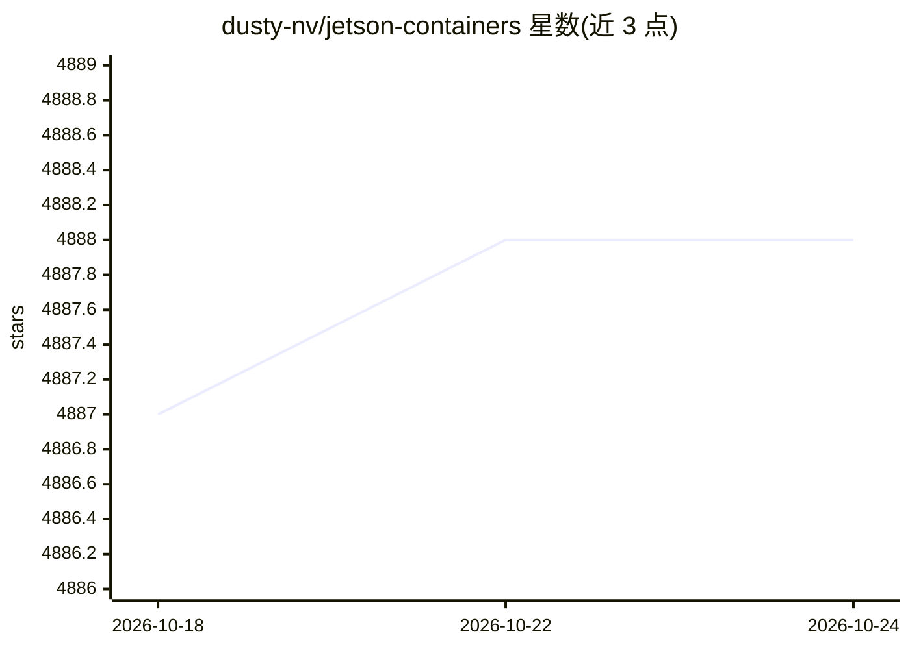

# dusty-nv/jetson-containers

⭐ 4,890 · Jupyter Notebook · NOASSERTION · 推送 2026-10-19 · [GitHub](https://github.com/dusty-nv/jetson-containers) · 个人维护

**给 Jetson 开发者的 AI/ML Docker 容器构建与运行工具集**

面向 NVIDIA Jetson / JetPack-L4T 边缘设备的模块化容器构建系统：预置 PyTorch、TensorFlow、vLLM、ollama、ROS、语音、视觉等大量 AI/ML 容器包，通过 jetson-containers build/run 命令组合包并构建镜像，autotag 按 JetPack/L4T 版本自动匹配可拉取或需构建的镜像；支持指定 CUDA/cuDNN/TensorRT/PyTorch 版本变量重建容器栈，并可启动本地 devpi PyPI 与 APT 缓存加速构建。安装方式为 git clone 后运行 install.sh。仅声明测试并支持 JetPack 6.2 与 JetPack 7。

## 筛选速览

| 维度 | 判定 | 备注 |
|---|---|---|
| AI 角色 | `ai-ecosystem` | LLM/agent 周边工具 |
| 许可风险 | `none` | NOASSERTION |
| 部署形态 | `self-host` | docker 或自建部署 |
| 模型依赖 | — | README 未给出锁定关系 |
| 硬件要求 | — | 无带数字的原话,不猜 |
| 安装摩擦 | `low` | 无编译、无系统依赖或容器化 |
| 成熟度 | — | 结构信号不足 |

## 能力要点

- 覆盖 ML/LLM/VLM/RAG/机器人等类别的预置容器包目录
- autotag 自动匹配 JetPack/L4T 版本兼容的镜像
- 通过 CUDA_VERSION 等环境变量切换 CUDA/cuDNN/TensorRT/PyTorch 版本
- 可选本地 devpi PyPI + APT 缓存服务器加速构建

## 适用场景

- 在 Jetson 上组合构建 ROS2 + PyTorch + Transformers 的自定义容器
- 直接拉取与自身 JetPack 版本兼容的 l4t-pytorch 等预构建镜像
- 边缘设备上运行 LLM/VLM 推理与语音容器

## 场景标签

 · 领域:边缘 AI/机器人基础设施

## 证据(README 行号)

> L6: Modular container build system that provides the latest **AI/ML packages** for NVIDIA Jetson :rocket::robot:
> L10: |**ML**|`pytorch` `tensorflow` `jax` `onnxruntime` `deepstream` `holoscan` `CTranslate2` `JupyterLab`|
> L11: |**LLM**|`SGLang` `vLLM` `MLC` `AWQ` `transformers` `text-generation-webui` `text-generation-inference` `ollama` `o
> L33: $ jetson-containers build --name=my_container pytorch transformers ros:humble-desktop

## 星数曲线

2026-10-18 4,887 → 2026-10-24 4,888（+1）

---
*卡片 v1 · prompt 1.4 · 生成 2026-10-20 · 置信度 mid · 依据 README sha `3b22016f99f7` · [字段定义](../../DATASET.md)*
