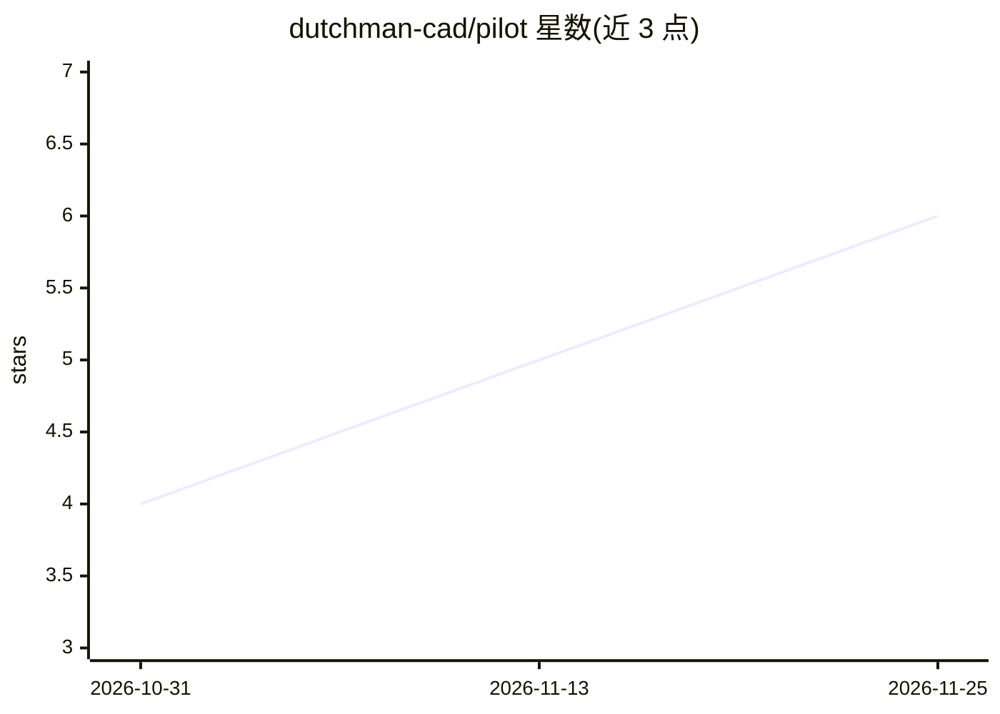

# dutchman-cad/pilot

⭐ 6 · Rust · Apache-2.0 · 推送 2026-11-23 · [GitHub](https://github.com/dutchman-cad/pilot) · 组织维护

**让本地小模型在 SolidCraft 中生成 CAD 零件的工具**

Pilot 作为本地模型与 SolidCraft 之间的代理运行：对可识别的请求调用预置配方（板件、型材、孔阵、外壳等），模型只填写尺寸等少量参数，随后用带校验的 SolidCraft 命令建件并测量；无配方匹配时由模型直接驱动工具，Pilot 负责修复工具调用与压缩上下文。通过 brew/scoop/安装脚本分发，需 Ollama 或 LM Studio 等本地端点提供模型。README 标注为早期 beta，盲测中配方路径成功率 68%，自由路径 12%。

## 筛选速览

| 维度 | 判定 | 备注 |
|---|---|---|
| AI 角色 | `ai-native` | 本体是模型或模型工具 |
| 许可风险 | `permissive` | Apache-2.0 |
| 部署形态 | `None` |  |
| 模型依赖 | local-ok | 支持本地模型 |
| 硬件要求 | — | 无带数字的原话,不猜 |
| 安装摩擦 | `low` | 无编译、无系统依赖或容器化 |
| 成熟度 | `idea` | |

## 能力要点

- 配方引擎：模型只填短表单，全值给定时跳过模型直接建件
- 支持 Ollama、LM Studio 或任意 chat-completions 端点的本地模型
- 自由路径下修复工具调用、重试并裁剪上下文
- 隐私声明：仅向用户选择的模型服务器发请求，不外发其他数据

## 适用场景

- 在本地笔记本上用小模型生成参数化 CAD 零件
- 用自然语言让 AI 在 SolidCraft 中建模盒子、型材、孔阵等
- 不联网的前提下让 AI 代理操作 CAD 软件

## 场景标签

`代码生成` · 领域:编码与开发

## 证据(README 行号)

> L3: Pilot: helps small local models drive SolidCraft
> L24: 2. Run a local model with Ollama, then start Pilot in front of it:
> L73: 1. **Recipes (almost all of the gain).** For a request that fits a known part (plates,

## 星数曲线

2026-10-31 4 → 2026-11-25 6（+2）

---
*卡片 v1 · prompt 1.4 · 生成 2026-11-21 · 置信度 high · 依据 README sha `71d756a40d85` · [字段定义](../../DATASET.md)*
