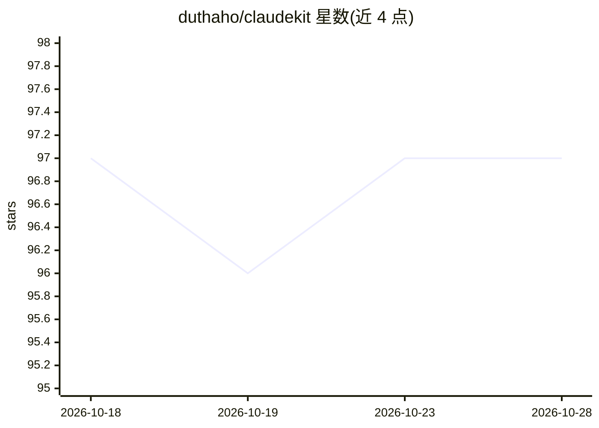

# duthaho/claudekit

⭐ 97 · JavaScript · MIT · 推送 2026-07-22 · [GitHub](https://github.com/duthaho/claudekit) · [官网](https://claudekit.duthaho.dev/) · 个人维护

**面向资深工程师的 Claude Code 验证优先工程工具集（15 技能+8 agent）**

以 Claude Code 插件形式提供的工程纪律工具集：包含 15 个技能与 8 个 agent，围绕'每个声明须有证据'组织为调查、设计、实现、验证、交付五阶段工作流。关键机制包括：各阶段强制产出指定工件、verification-gate 在'完成'声明前运行测试与非 IDE 环境验证、每个技能内嵌可跳步借口对照表、计划由架构与体验双评审打分。通过 /claudekit:init 脚手架化规则、钩子与 MCP 服务器配置，附带 5 种输出风格与证据校验脚本。要求 Claude Code 1.0+ 与 Git，MIT 许可。

## 筛选速览

| 维度 | 判定 | 备注 |
|---|---|---|
| AI 角色 | `ai-ecosystem` | LLM/agent 周边工具 |
| 许可风险 | `permissive` | MIT |
| 部署形态 | `None` |  |
| 模型依赖 | — | README 未给出锁定关系 |
| 硬件要求 | — | 无带数字的原话,不猜 |
| 安装摩擦 | `low` | 无编译、无系统依赖或容器化 |
| 成熟度 | — | 结构信号不足 |

## 能力要点

- 15 个技能覆盖调查/设计/实现/验证/交付五阶段，各阶段强制产出证据工件
- verification-gate 在完成声明前运行测试、检查负路径并在非 IDE 环境验证
- 8 个 agent 含 OWASP 对齐的安全审计 agent
- verify-evidence.cjs 校验 file:line 引用、检测假绿篡改并重跑测试比对声明结果

## 适用场景

- 为 Claude Code 上的编码工作流强加验证与证据纪律
- 在代码合入前自动运行结构评审与敏感路径安全审计
- 发布前做依赖审计与基于 diff 的变更日志生成

## 场景标签

`编码 Agent` `代码审查` `提示工程` · 领域:Agent 开发

## 证据(README 行号)

> L3: A **verification-first engineering toolkit** for Claude Code. Built for senior ICs and tech leads who already know h
> L5: 15 skills, 8 agents, one philosophy: **every claim has evidence.** No `tests pass — trust me`. No `it works in my ID
> L36: All 15 skills are user-invocable as `/claudekit:<name>`.

## 星数曲线

2026-10-18 97 → 2026-10-28 97（+0）

---
*卡片 v1 · prompt 1.4 · 生成 2026-10-23 · 置信度 high · 依据 README sha `c3a4538f8f79` · [字段定义](../../DATASET.md)*
